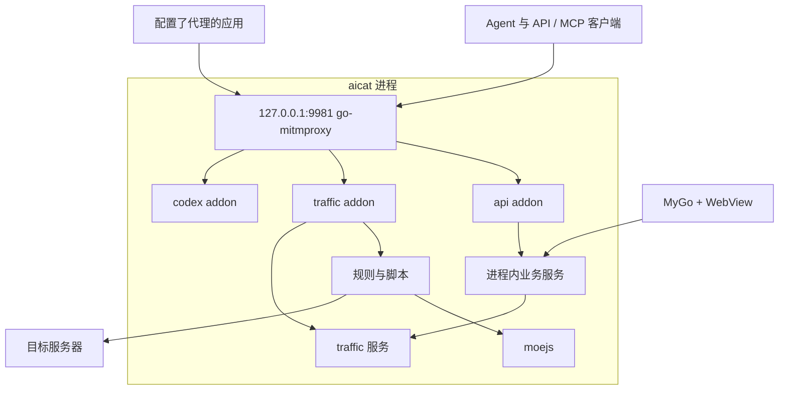

# 架构

aicat 是安装在用户节点上的常驻 Agent Gateway，由一个 Go 进程承载：MyGo + 系统 WebView 提供桌面界面，go-mitmproxy 提供代理入口，moejs 执行脚本插件。`127.0.0.1:9981` 是统一 HTTP 入口，既接收代理流量，也承载 aicat 自身的 API、MCP 与模型转发路由。不引入外部 runtime 二进制。

产品定位与领域术语见 [CONTEXT.md](../CONTEXT.md)，用户可见功能见 [Feature map](feature-map/README.md)，构建与验证见 [开发约定](development.md)。本文只描述模块边界、数据流和需要遵守的约束。

## 组件

| 组件 | 职责 |
| --- | --- |
| MyGo | 窗口、托盘、菜单、快捷键、桌面生命周期，Go 服务到前端的类型绑定 |
| go-mitmproxy | HTTP 代理、CONNECT、TLS 解密、上游连接与流量钩子 |
| moejs | 编译并执行 JS/TS 插件，提供 Go 与脚本之间的数据和函数调用 |
| aicat | 装配上述组件，管理配置、CA、系统代理、规则、插件、流量记录、供应商与 API/MCP |



桌面进程就是运行体；`aicat-cli serve` 是同一组业务服务的无界面入口，不创建窗口和托盘。关闭主窗口只隐藏窗口，显式退出才停止网关。

## 包边界

| 包 | 职责 | 依赖边界 |
| --- | --- | --- |
| `internal/app` | 应用装配、`Desktop` 服务、窗口/托盘/剪贴板/系统对话框 | 组合其余包；业务包不回调 `app` |
| `internal/gateway` | 装配代理、连接生命周期、CA 注入、解密选择与直接出站 | 使用 go-mitmproxy，不依赖 MyGo，不承载业务规则 |
| `internal/gateway/addons/api` | 把 HTTP handler 接入监听地址 | 只识别发给 aicat 的请求，不接管代理站点的同名路径 |
| `internal/gateway/addons/traffic` | 把代理阶段转成流量观测，编排四阶段改写 | 使用 traffic 的写入接口与 rewrite，不依赖 UI |
| `internal/gateway/addons/codex` | Codex 扩展的解密入口 | 调用 `internal/codex` |
| `internal/traffic` | 流量模型、有界记录、body 读取、查询与变化订阅 | 不依赖 gateway、go-mitmproxy、MyGo 或 moejs |
| `internal/rewrite` | 规则与插件文件管理、启动快照、事务化四阶段执行 | 调用 plugins，不依赖 UI、`proxy.Flow` 或 traffic |
| `internal/plugins` | moejs 编译、隔离调用与宿主绑定 | 不依赖 gateway、traffic 或 MyGo |
| `internal/mcpserver` | 规则、插件与流量查询的 MCP 适配 | 复用进程内服务，在入口认证 |
| `internal/provider` | 供应商密钥存储、模型列表同步、带密钥的转发路由 | 不依赖 UI |
| `internal/codex`、`internal/catalog` | Codex 模型列表合并与按模型分流；models.dev 目录 | 调用 provider |
| `internal/certificate` | 根证书身份、当前用户信任的检测与管理 | 不属于 gateway |
| `internal/systemproxy` | 系统代理的接管、恢复日志与恢复 | 不属于 gateway |
| `internal/config` | 串行、原子地读写唯一的 `aicat.yaml` | 保留未知字段与注释 |

涉及网关的业务一律是 `internal/gateway/addons/<业务>/` 下的 `proxy.Addon`；持久化、插件 runtime 与业务查询是普通 Go 包，由 addon 或控制服务调用。规则与脚本阶段由 traffic addon 明确编排，不依赖多个 addon 的注册顺序。go-mitmproxy 的缺口在 addon 侧适配，必要时向上游提交补丁，不维护私有 fork。

前端位于独立的 `ui/`（Vue 3 + TypeScript + Vite）。Go 的 `Desktop` 是前后端接口的唯一声明，MyGo 由它生成类型客户端；桌面绑定不监听 TCP。详见 [开发约定](development.md)。

## 统一入口

同一 listener 识别三种请求：

| 请求形态 | 处理方式 |
| --- | --- |
| CONNECT | 按解密选择进入 TLS MITM 或原样隧道转发 |
| absolute-form HTTP 请求 | 作为代理请求进入 traffic addon |
| 以 aicat 为目标的请求 | 由 api addon 交给 API、MCP、供应商与 Codex 的 HTTP handler |

控制路由同时核对 TCP peer（loopback 或本机地址）、目标 authority 和 Origin，不只匹配路径；监听 `0.0.0.0` 时控制接口仍只对本机开放。控制流量不进入采集与用户脚本。MCP 另外核对 Bearer token。

网关最终转发使用直接连接的 transport，不继承指向自身的 `HTTP_PROXY`/`HTTPS_PROXY`。插件 SDK 不提供网络 API。

WebView 经 MyGo 绑定调用进程内服务，通过 Channel 接收合并后的流量变化，通过 typed event 得知设置状态失效。HTTP API 与 MCP 经监听地址调用同一组服务，复用数据模型、校验和错误语义。

## 网关生命周期

```go
type Options struct {
    Addr              string
    CA                cert.CA
    ShouldIntercept   func(*http.Request) bool
    BufferedBodyLimit int64
    Addons            []proxy.Addon
}

func New(options Options) (*Gateway, error)
func (g *Gateway) Run(ctx context.Context) error
func (g *Gateway) Ready() <-chan struct{}
func (g *Gateway) Status() Status
func (g *Gateway) Shutdown(ctx context.Context) error
```

- `New` 只校验参数并固定 addon 顺序，不监听端口、不安装证书、不修改系统代理。
- `ShouldIntercept` 未提供时全部透传，不继承库的“默认全部解密”。
- `Ready` 用随机路径与响应标记确认当前实例可处理请求，端口可连接不算就绪。
- `Rebind` 保持 Gateway、CA 和采集服务不变，串行切换底层监听：地址不冲突时先启动新入口再关闭旧入口；同端口重叠时先释放旧监听，失败则恢复。系统代理与配置保存由应用层的连接控制串行协调，失败回退。
- `Shutdown` 幂等：阻止新连接，在期限内等待普通请求，再主动关闭 CONNECT、WebSocket 等长连接。
- `ResetConnections` 只断开已有会话，用于根证书删除；监听与普通转发保持可用。

已知上游限制（go-mitmproxy v1.9.4）：`Close`/`Shutdown` 不关闭内部 attacker server，反复切换监听会累积内部等待协程；直通 CONNECT 可能因上游半连接推迟 `Flow.Done`，traffic addon 以客户端断开作为隧道记录的结束边界。这两处等待上游修复，不用反射或私有 fork 绕过。

## 流量处理

可缓冲的 HTTP 交换按以下阶段处理：

```text
收到请求 headers  → 保存客户端原始 headers → onRequestHeaders
读取完整请求 body → onRequest → 保存实际发送的请求，发往上游
收到响应 headers  → 保存上游原始 headers → onResponseHeaders
读取完整响应 body → onResponse → 保存实际返回的响应，返回客户端
```

- 每条普通 HTTP 或已解密 HTTPS 交换持有一个 Session，固定启动时的规则版本；每阶段按当前 URL/method 重新匹配，后一条规则看到前一条成功提交的结果。
- 原始内容在脚本执行前保存。脚本结果通过校验后才提交；异常、超时或非法输出只撤销当前调用，继续转发并记录错误。
- `onRequest` 可返回自定义响应，短路上游，但仍进入两个响应阶段各一次。
- 流式与超过 `bufferedBodyLimit` 的 body 边读边转发，完整 body 钩子记为 skipped；大请求会使其响应也走流式。SSE 在响应 headers 阶段固定为流式。未解密 CONNECT 与 Upgrade 不执行插件。
- 采集上限只截断记录，不截断实际转发的内容。

## traffic 服务

```go
func (s *Service) List(ctx context.Context, query Query) (Page, error)
func (s *Service) Get(ctx context.Context, id ID) (Record, error)
func (s *Service) OpenBody(ctx context.Context, id BodyID) (Body, error)
func (s *Service) Watch(ctx context.Context, query Query) (Page, *Subscription, error)
func (s *Service) Recorder() *Recorder
```

UI、HTTP API 与 MCP 读取同一个服务实例；`Recorder` 是只交给代理 addon 的写入接口（`Begin` / `Update` / `Finish`）。

- **记录**：以一次 HTTP 交换为单位，在请求 headers 到达时创建。有界内存保存，默认 2,000 条、单 body 256 KiB、全部 body 64 MiB；超出按最旧 ID 淘汰或标明截断。进程退出即清空。
- **请求 ID**：从 1 自增，同一请求的各阶段共用；清空不复用，重启后重新编号。
- **观测位置**：`RequestReceived`、`RequestSent`、`ResponseReceived`、`ResponseSent`，分别是改写前后的语义快照。nil 表示该位置尚未发生或被短路。未修改的 body 共用引用。记录表达 HTTP 语义，不承诺还原 TCP/TLS 原始字节，也不保证头部的原始大小写与顺序。
- **Revision**：单条记录的版本，用于识别过时的查询结果，不是事件编号。
- **Body**：`List` 只返回摘要，`Get` 返回 headers 与 body 引用，内容经 `OpenBody` 按需读取。状态区分待采集、完整、截断、未采集和采集失败；打开得到固定长度的只读快照。
- **Watch**：在同一同步边界内取得初始列表并登记订阅，之后的变化不会落入空窗。通知只含类型与请求 ID，不带记录内容，也没有可续接的事件日志。订阅有容量上限，放不下时以 `ErrSlowSubscriber` 关闭，消费者重新 Watch。
- **背压**：写端只在短临界区提交有界元数据，不等待订阅者、脚本或 UI。UI 与查询的延迟不回压代理流量。
- **应用归属**：macOS 上由 traffic addon 在首次记录回环连接时异步匹配 TCP 两端，得到可选的 `clientApp`（名称与 bundle ID），经 Revision 刷新到已有记录。

`Desktop.WatchTraffic` 每 100ms 合并一次摘要增量推给页面；详情与正文按需读取，并用请求 ID、Revision 与页面请求代次丢弃过时结果。

## 脚本插件

用户插件是启动时加载的单文件 JS/TS 模块，不生成 Go 代码、不重新编译 aicat：

```text
~/.aicat/plugins/example/
├── plugin.json
└── index.ts
```

| 钩子 | 时机 | 能力 |
| --- | --- | --- |
| `onRequestHeaders` | 收到请求 headers | 修改 URL、method、请求 headers |
| `onRequest` | 请求 body 完整可用 | 修改请求 body，或生成自定义响应 |
| `onResponseHeaders` | 收到响应 headers | 修改状态码、响应 headers |
| `onResponse` | 响应 body 完整可用 | 修改响应 body |

- 插件拿到受控输入并返回显式结果，不接触 `proxy.Flow`。headers 用小写名称与多值数组；body 是解压后实体的 base64；body 变化后由宿主修正长度并移除旧编码。
- 宿主只提供有界 console 日志、`host.settings`、`host.bodyText` 与 `host.bodyFromText`，没有网络、文件系统或进程访问，也不支持 import/npm。
- 编译后的模块共享，每次调用使用独立 runtime；同一规则在请求内的状态经 `message.context` 显式传递（最多 16 KiB）。
- 默认每阶段总时限 200ms（含排队与整条规则链）、并发 8、runtime 32 MiB、完整 body 1 MiB。预算用于约束成本，不等同于进程隔离。
- 规则保存在 `aicat.yaml` 的 `rewrite`，插件代码保存在 Home 的 `plugins/`，删除的插件移入 `trash/plugins`。两者保存后重启生效；`revision` 是已保存版本，`activeRevision` 是启动快照。管理操作可带 `expectedRevision` 防止覆盖并发编辑。

清单字段、数据格式与 Agent 的编写流程以 [插件 SDK](../internal/mcpserver/guide.md) 为准。所有扩展须遵守 [扩展规范](extension-standard.md)；扩展包与消息扩展的后续设计见 [扩展包草案](extension-packages-design.md) 和 [消息扩展草案](message-extension-design.md)。

## 配置与本机状态

`~/.aicat/aicat.yaml` 是唯一持久行为配置，`--home` 可选择隔离目录。配置更新走同一个串行、原子替换的入口，保存成功后才更新运行状态。Home 中其余文件是各自的数据，不是第二份行为配置：

| 路径 | 内容 |
| --- | --- |
| `ca/` | 根证书与私钥（目录 0700，私钥 0600），私钥不导入钥匙串 |
| `mcp-token` | MCP 的 Bearer 凭据（0600） |
| `providers.json`、`provider-models.json` | 供应商密钥（0600）与同步到的模型列表 |
| `plugins/`、`trash/plugins/` | 脚本插件及已删除的插件 |
| `state/system-proxy.json` | 系统代理的恢复日志 |
| `cache/models-dev.json` | models.dev 目录的本地副本 |

证书与系统代理遵循以下约束：

- 根证书在本机生成并复用；系统信任只在用户点击“安装证书”后进入 macOS 授权，状态以当前指纹和实际 SSL 验证结果为准。启动或选择解密域名都不会自动安装信任。
- 删除证书先持久记录意图、停止签发并断开既有连接，系统移除完成后才清理本地身份；取消或失败可重试，期间新 HTTPS 连接直通。
- 系统代理默认关闭，与常驻监听相互独立。接管前保存原设置，关闭、停止网关或退出时恢复；异常退出后下次启动先恢复再按意图接管。外部修改不覆盖，恢复失败时保留监听与恢复入口。
- Agent 经 API/MCP 发起的操作沿用相同的用户授权边界，不因调用来源而扩大权限。

## 参考

- [MyGo 文档](https://mygo.egoist.dev/docs/frontend)
- [go-mitmproxy addon 接口](https://github.com/lqqyt2423/go-mitmproxy/blob/v1.9.4/proxy/addon.go) 与 [Flow](https://github.com/lqqyt2423/go-mitmproxy/blob/v1.9.4/proxy/flow.go)
- [moejs 指南](https://github.com/MoeForge/moejs/blob/main/docs/guide.md)
