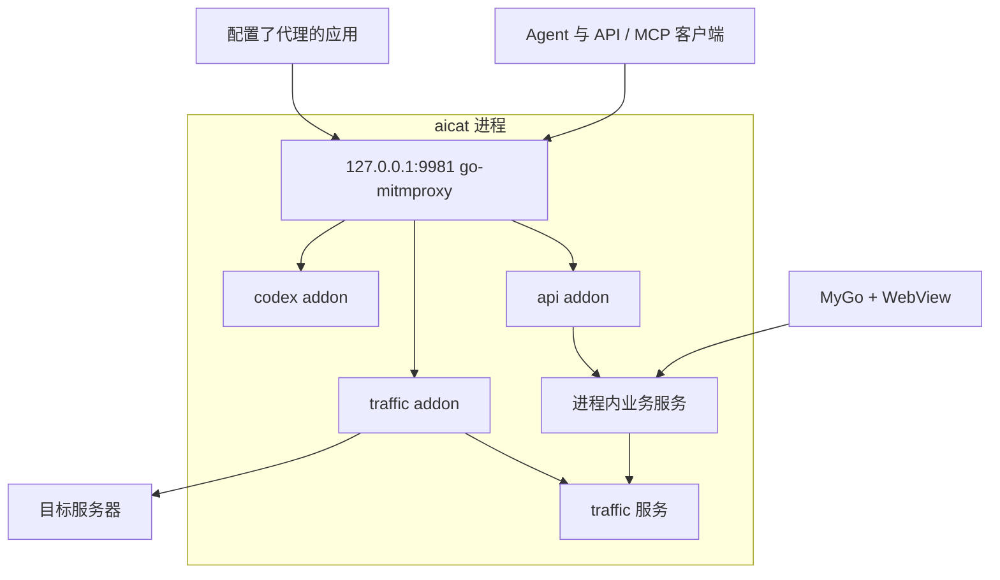

# 架构

aicat 是安装在用户节点上的常驻 Agent Gateway，核心由 Go 进程承载：MyGo + 系统 WebView 提供桌面界面，go-mitmproxy 提供代理入口与流量钩子。`127.0.0.1:9981` 是统一 HTTP 入口，既接收代理流量，也承载 aicat 自身的 API、MCP 与模型转发路由。企业微信 BOT 与只读企业微信客户端扩展按需启动各自的应用内置 Bun 宿主，用户无需安装外部运行时。

产品定位与领域术语见 [CONTEXT.md](../CONTEXT.md)，用户可见功能见 [Feature map](feature-map/README.md)，构建与验证见 [开发约定](development.md)。本文只描述模块边界、数据流和需要遵守的约束。

## 组件

| 组件 | 职责 |
| --- | --- |
| MyGo | 窗口、托盘、菜单、快捷键、桌面生命周期，Go 服务到前端的类型绑定 |
| go-mitmproxy | HTTP 代理、CONNECT、TLS 解密、上游连接与流量钩子 |
| aicat | 装配上述组件，管理配置、CA、系统代理、流量记录、供应商与 API/MCP |



桌面进程就是运行体；`aicat-cli serve` 是同一组业务服务的无界面入口，不创建窗口和托盘。关闭主窗口只隐藏窗口，显式退出才停止网关。

## 包边界

| 包 | 职责 | 依赖边界 |
| --- | --- | --- |
| `internal/app` | 应用装配、`Desktop` 服务、窗口/托盘/剪贴板/系统对话框 | 组合其余包；业务包不回调 `app` |
| `internal/gateway` | 装配代理、连接生命周期、CA 注入、解密选择与直接出站 | 使用 go-mitmproxy，不依赖 MyGo，不承载业务规则 |
| `internal/gateway/addons/api` | 把 HTTP handler 接入监听地址 | 只识别发给 aicat 的请求，不接管代理站点的同名路径 |
| `internal/gateway/addons/traffic` | 把代理阶段转成流量观测 | 使用 traffic 的写入接口，不依赖 UI |
| `internal/traffic` | 流量模型、有界记录、body 读取、查询与变化订阅 | 不依赖 gateway、go-mitmproxy 或 MyGo |
| `internal/mcpserver` | 流量查询与 messages_send 的 MCP 适配 | 复用进程内服务，在入口认证 |
| `internal/provider` | 供应商密钥存储、模型列表同步、带密钥的转发路由 | 不依赖 UI；转发时把调用交给 usage 记录 |
| `internal/usage` | 模型调用的用量记录、从回复读取 Token、按时段汇总与 `/api/usage` | 不依赖 provider、traffic 或 UI |
| `internal/extension` | 内置扩展的登记与启停：扩展交出 addon、额外解密判断、路由与后台任务，宿主只在扩展启用时使用它们 | 不导入任何具体扩展 |
| `internal/codex` | Codex 扩展：模型列表合并、按模型分流、解密入口与 models.dev 目录（`catalog/`） | 只依赖 extension 与核心包 |
| `internal/channelhost` | 应用内 Bun 宿主的 stdio、账号会话、子进程启停 | 不依赖 UI 或具体平台协议 |
| `internal/messages` | 账号凭据、CloudEvent 校验、Room 追加日志、持久任务调度及发送回执 | 不依赖 MyGo 或具体渠道，复用 channelhost |
| `internal/agent` | Codex app-server 子进程、JSONL 协议、Room thread 与受限动态工具调用 | 不依赖消息渠道或 UI，发送通过调用方提供的回调 |
| `internal/wecomlocal` | 企业微信客户端扩展声明、本地读取器生命周期与只读消息接入 | 平台数据库解析留在 Bun TS 读取器，复用 messages 的 Inbox 和 Room 存储 |
| `internal/channelplugin` | 官方渠道目录、安装暂存、包声明校验与安装记录 | 不依赖 UI、消息处理或具体平台通信 |
| `internal/certificate` | 根证书身份、当前用户信任的检测与管理 | 不属于 gateway |
| `internal/systemproxy` | 系统代理的接管、恢复日志与恢复 | 不属于 gateway |
| `internal/config` | 串行、原子地读写唯一的 `aicat.yaml` | 保留未知字段与注释 |

核心的网关业务是 `internal/gateway/addons/<业务>/` 下的 `proxy.Addon`；扩展的 addon 放在扩展自己的目录，经 `internal/extension` 接入，内置扩展只在 `internal/app/extensions.go` 登记一行，界面按 `ui/src/extensions/<ID>/` 目录自动加载（见 [扩展规范](extension-standard.md)）。持久化与业务查询是普通 Go 包，由 addon 或控制服务调用。go-mitmproxy 的缺口在 addon 侧适配，必要时向上游提交补丁，不维护私有 fork。

扩展 UI 的 Body、Settings、Diagnostics 由各自目录声明：详情承载说明与启停，SettingsPage 挂载统一设置，诊断页承载任务、测试与日志；页面移动复用同一 Desktop 消息服务，不新增配置存储或管理 listener。

前端位于独立的 `ui/`（Vue 3 + TypeScript + Vite）。Go 的 `Desktop` 是前后端接口的唯一声明，MyGo 由它生成类型客户端；桌面绑定不监听 TCP。详见 [开发约定](development.md)。

## 统一入口

同一 listener 识别三种请求：

| 请求形态 | 处理方式 |
| --- | --- |
| CONNECT | 按解密选择进入 TLS MITM 或原样隧道转发 |
| absolute-form HTTP 请求 | 作为代理请求进入 traffic addon |
| 以 aicat 为目标的请求 | 由 api addon 交给 API、MCP、供应商与 Codex 的 HTTP handler |

控制路由同时核对 TCP peer（loopback 或本机地址）、目标 authority 和 Origin，不只匹配路径；监听 `0.0.0.0` 时控制接口仍只对本机开放。控制流量不进入采集。MCP 另外核对 Bearer token。

网关最终转发使用直接连接的 transport，不继承指向自身的 `HTTP_PROXY`/`HTTPS_PROXY`。未进入 TLS 隧道的请求使用代理库提供的独立 HTTP 客户端，按目标复用连接；同一客户端代理连接可交替访问多个站点。CONNECT 与已解密 TLS 继续使用对应隧道的传输链路。

WebView 经 MyGo 绑定调用进程内服务，通过 Channel 接收合并后的流量变化，通过 typed event 得知设置状态失效。HTTP API 与 MCP 经监听地址调用同一组服务，复用数据模型、校验和错误语义。

## 网关生命周期

```go
type Options struct {
    Addr              string
    CA                cert.CA
    ShouldIntercept   func(*http.Request) bool
    BufferedBodyLimit int64
    Addons            []proxy.Addon
}

func New(options Options) (*Gateway, error)
func (g *Gateway) Run(ctx context.Context) error
func (g *Gateway) Ready() <-chan struct{}
func (g *Gateway) Status() Status
func (g *Gateway) Shutdown(ctx context.Context) error
```

- `New` 只校验参数并固定 addon 顺序，不监听端口、不安装证书、不修改系统代理。
- `ShouldIntercept` 未提供时全部透传，不继承库的“默认全部解密”。
- `Ready` 用随机路径与响应标记确认当前实例可处理请求，端口可连接不算就绪。
- `Rebind` 保持 Gateway、CA 和采集服务不变，串行切换底层监听：地址不冲突时先启动新入口再关闭旧入口；同端口重叠时先释放旧监听，失败则恢复。系统代理与配置保存由应用层的连接控制串行协调，失败回退。
- `Shutdown` 幂等：阻止新连接，在期限内等待普通请求，再主动关闭 CONNECT、WebSocket 等长连接。
- `ResetConnections` 只断开已有会话，用于根证书删除；监听与普通转发保持可用。

已知上游限制（go-mitmproxy v1.9.4）：`Close`/`Shutdown` 不关闭内部 attacker server，反复切换监听会累积内部等待协程；直通 CONNECT 可能因上游半连接推迟 `Flow.Done`，traffic addon 以客户端断开作为隧道记录的结束边界。这两处等待上游修复，不用反射或私有 fork 绕过。

## 流量处理

可缓冲的 HTTP 交换按以下阶段处理：

```text
收到请求 headers  → 保存请求观测
读取完整请求 body → 保存请求正文及发送观测，发往上游
收到响应 headers  → 保存响应观测
读取完整响应 body → 保存响应正文及发送观测，返回客户端
```

- 流式与超过 `bufferedBodyLimit` 的 body 边读边转发，大请求会使其响应也走流式；SSE 在响应 headers 阶段固定为流式。
- 未解密 CONNECT 作为不透明隧道观测；采集上限只截断记录，不截断实际转发内容。
- 关闭采集只停止新记录，既有观测继续完成，代理转发继续运行。

## traffic 服务

```go
func (s *Service) List(ctx context.Context, query Query) (Page, error)
func (s *Service) Get(ctx context.Context, id ID) (Record, error)
func (s *Service) OpenBody(ctx context.Context, id BodyID) (Body, error)
func (s *Service) Watch(ctx context.Context, query Query) (Page, *Subscription, error)
func (s *Service) Recorder() *Recorder
```

UI、HTTP API 与 MCP 读取同一个服务实例；`Recorder` 是只交给代理 addon 的写入接口（`Begin` / `Update` / `Finish`）。

- **记录**：以一次 HTTP 交换为单位，在请求 headers 到达时创建。有界内存保存，默认 2,000 条、单 body 256 KiB、全部 body 64 MiB；超出按最旧 ID 淘汰或标明截断。进程退出即清空。
- **请求 ID**：从 1 自增，同一请求的各阶段共用；清空不复用，重启后重新编号。
- **观测位置**：`RequestReceived`、`RequestSent`、`ResponseReceived`、`ResponseSent`，分别是接收及发送位置的语义快照。nil 表示该位置尚未发生或被短路。未修改的 body 共用引用。记录表达 HTTP 语义，不承诺还原 TCP/TLS 原始字节，也不保证头部的原始大小写与顺序。
- **Revision**：单条记录的版本，用于识别过时的查询结果，不是事件编号。
- **Body**：`List` 只返回摘要，`Get` 返回 headers 与 body 引用，内容经 `OpenBody` 按需读取。状态区分待采集、完整、截断、未采集和采集失败；打开得到固定长度的只读快照。
- **Watch**：在同一同步边界内取得初始列表并登记订阅，之后的变化不会落入空窗。通知只含类型与请求 ID，不带记录内容，也没有可续接的事件日志。订阅有容量上限，放不下时以 `ErrSlowSubscriber` 关闭，消费者重新 Watch。
- **背压**：写端只在短临界区提交有界元数据，不等待订阅者或 UI。UI 与查询的延迟不回压代理流量。
- **应用归属**：macOS 上由 traffic addon 在首次记录回环连接时异步匹配 TCP 两端，得到可选的 `clientApp`（名称与 bundle ID），经 Revision 刷新到已有记录。

`Desktop.WatchTraffic` 每 100ms 合并一次摘要增量推给页面；详情与正文按需读取，并用请求 ID、Revision 与页面请求代次丢弃过时结果。

## 扩展执行

内置扩展与可安装渠道共同经 internal/extension 管理。流量和 Codex 在 Go 进程内执行；channelplugin 目录声明的官方渠道由同一宿主登记，不逐个编写 Go 扩展。企业微信是当前受支持的可安装渠道。应用只携带 Bun、宿主和 SDK 兼容层；用户安装时使用应用内 Bun 下载官方 npm 包和依赖，禁用安装脚本、校验包声明后原子登记。启用时只读本地包，不安装依赖。SDK 兼容层由应用资源提供，已安装包通过链接引用，启动时本地迁移旧拷贝和应用路径，不重复下载插件。实验与生产复用同一份 shim 源码。

消息配置验证与正式启用分开：验证通过官方 SDK 做短连接鉴权，不运行入站消息处理；凭据与安装版本的验证指纹有效后才允许启用。插件原样加载，兼容层当前仅覆盖企业微信长连接私聊文本与主动发送，工具、CLI、Webhook 等能力不注册到应用。messages 的 Room 存储复用 JSONL 追加、尾部修复和原子落盘，任务存储在启动时恢复历史并维护待处理索引及最近快照。消息编排负责提示词、trigger_messages 和发送工具定义；agent 只负责 Codex 协议，按 Room 使用 turn/start 或 turn/steer。普通回复经统一主动发送和分段回执服务处理。详情见[企业微信 BOT](feature-map/wecom.md)。完整目标仍见[渠道扩展草案](message-extension-design.md)和[扩展包草案](extension-packages-design.md)。

企业微信客户端是独立内置扩展 `wecom-local`，运行专用 Bun stdio 宿主，不加载 BOT 插件。`runtime/channel-host/wecom-local/` 负责文件快照、页解密、WAL 校验重放、消息解析及确认后的游标保存；`internal/wecomlocal` 只负责配置和生命周期，消息交给 `messages.Inbox`。Inbox 复用现有 Room 追加和同步落盘，以摘要索引校验确定性事件 ID 的重放并补齐上下文，不创建 Agent 任务。扩展的 Messages 接缝以接口提供配置、状态和发送能力；只读渠道明确拒绝发送及 Agent 配置，详见[企业微信客户端](feature-map/wecom-local.md)。

旧配置若仍启用 rewrite 或包含规则，启动明确报不支持，不静默跳过。旧插件文件不由主程序加载，也不自动删除。

`~/.aicat/aicat.yaml` 是唯一持久行为配置，`--home` 可选择隔离目录。配置更新走同一个串行、原子替换的入口，保存成功后才更新运行状态。Home 中其余文件是各自的数据，不是第二份行为配置：

| 路径 | 内容 |
| --- | --- |
| `ca/` | 根证书与私钥（目录 0700，私钥 0600），私钥不导入钥匙串 |
| `mcp-token` | MCP 的 Bearer 凭据（0600） |
| `providers.json`、`provider-models.json` | 供应商密钥（0600）与同步到的模型列表 |
| `usage.jsonl` | 模型调用的用量记录（0600，只追加） |
| `state/system-proxy.json` | 系统代理的恢复日志 |
| `credentials/wecom.json` | 企业微信 Bot ID 与 Secret，0600，仅配置和连接读取 |
| `state/wecom-local/` | 企业微信客户端宿主锁与按账号、数据目录隔离的读取游标；密钥只引用外部已有文件 |
| `state/channel-host/` | 宿主未确认消息与进程锁，不是 Room 历史 |
| `rooms/*/messages.jsonl`、`rooms/*/context/messages.log` | 按账号和会话隔离的事件流水与纯消息上下文 |
| `extensions/<ID>/<版本>/` | 官方渠道包、依赖锁与安装记录 |
| `rooms/*/agent.json`、`rooms/*/tasks/` | Room 的 Codex thread 绑定与持久执行状态，结果不明不重放 |
| `messages/receipts/` | 出站 source+id 的持久回执；pending/unknown 不自动重发 |
| `cache/models-dev.json` | models.dev 目录的本地副本 |

证书与系统代理遵循以下约束：

- 根证书在本机生成并复用；系统信任只在用户点击“安装证书”后进入 macOS 授权，状态以当前指纹和实际 SSL 验证结果为准。启动或选择解密域名都不会自动安装信任。
- 删除证书先持久记录意图、停止签发并断开既有连接，系统移除完成后才清理本地身份；取消或失败可重试，期间新 HTTPS 连接直通。
- 系统代理默认关闭，与常驻监听和证书信任相互独立。开关直接生效；正常接管的备份不属于待恢复故障。接管前保存原设置，关闭、停止网关或退出时恢复；异常退出后下次启动先恢复再按意图接管。外部修改不覆盖，恢复失败时保留监听与恢复入口。
- Agent 经 API/MCP 发起的操作沿用相同的用户授权边界，不因调用来源而扩大权限。

## 参考

- [MyGo 文档](https://mygo.egoist.dev/docs/frontend)
- [go-mitmproxy addon 接口](https://github.com/lqqyt2423/go-mitmproxy/blob/v1.9.4/proxy/addon.go) 与 [Flow](https://github.com/lqqyt2423/go-mitmproxy/blob/v1.9.4/proxy/flow.go)
