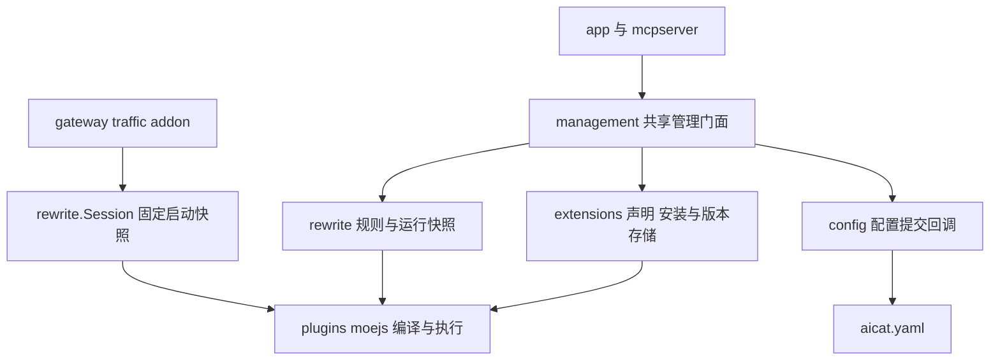

# aicat 扩展包与改写能力设计草案

状态：待评审。首版支持一个扩展包提供一个 moejs 改写脚本，继续由规则决定作用范围、顺序和参数。安装管理复用桌面端与 MCP 的同一组进程内服务；执行复用现有四阶段改写链。

## 当前接缝

| 现有模块 | 已有职责 | 扩展包接入后的职责 |
| --- | --- | --- |
| `internal/plugins` | 清单读取、单文件 JS/TS 编译、moejs 隔离调用、宿主绑定 | 保留编译与执行；文件位置通过解析接口提供 |
| `internal/rewrite` | 规则匹配、排序、配置管理、插件文件管理、启动快照、试运行 | 保留规则语义与执行；抽出文件管理和共享提交协调 |
| `internal/gateway/addons/traffic` | 编排四阶段改写与采集 | 沿用当前 Session，不读取安装目录、不下载或安装扩展 |
| `internal/config` | 原子更新唯一 `aicat.yaml` | 同一次提交保存扩展记录和相关规则，保留无关字段 |
| `internal/app` 与 `internal/mcpserver` | UI 与 MCP 适配 | 调用同一管理服务，展示已保存和实际运行状态 |

当前 `rewrite.Service` 同时拥有规则配置和插件文件的读写锁。直接给它加入下载、解包和版本目录，会使安装管理与执行规则继续耦合。实现前先拆分下面的管理职责；本草案不改变当前运行行为。

## 包声明

发布包使用 ZIP，根目录直接包含 `plugin.json` 和一个入口文件；可以附带 `README.md`、`LICENSE`。作者在发布前完成构建或打包，宿主只读取声明和单文件入口。

```text
header-label.aicat.zip
├── plugin.json
├── index.ts
├── README.md
└── LICENSE
```

沿用现有 `plugin.json`，新增包格式版本、展示信息和能力声明：

```json
{
  "manifestVersion": 1,
  "apiVersion": 1,
  "id": "com.example.header-label",
  "name": "Header Label",
  "version": "1.0.0",
  "description": "为匹配请求添加调试标记",
  "author": "Example",
  "license": "MIT",
  "repository": "https://github.com/example/header-label",
  "main": "index.ts",
  "contributes": {
    "rewrite": {
      "hooks": ["onRequestHeaders"]
    }
  }
}
```

`manifestVersion` 负责包格式兼容，`apiVersion` 继续表示现有脚本 SDK v1。`id` 沿用当前 1–64 字符的规则，首字符为字母或数字，其余允许字母、数字、点、下划线和连字符。新包保留 `builtin.` 前缀给内置能力；相同 ID 在已安装包和既有本地脚本之间不得冲突。发布包的 `version` 使用完整 SemVer；既有本地脚本保留原有版本字符串。

首版必填字段为两个版本字段、`id`、`name`、`version`、`main` 与 `contributes.rewrite.hooks`；展示字段可选。`main` 只允许 `index.js` 或 `index.ts`，入口最多 512 KiB。清单最多 64 KiB。未知能力、未知控制字段、不支持的格式或 SDK 版本均拒绝安装，不静默忽略。展示文本只作为文本处理。

`hooks` 必须非空、无重复，且与编译模块实际导出的四阶段钩子集合一致。实际执行只调度已声明的钩子。清单的作者和仓库信息是作者提供的展示数据；安装来源由宿主单独记录，不能由清单自行声明为社区审核或内置。

扩展包读取器先验证完整声明，再将 SDK 所需的 `apiVersion/id/name/version/main` 投影给现有编译器；展示信息和安装来源不传入 JS。读取器的新增字段是受控支持，不把当前严格的清单解析改成任意字段透传。

每包首版只有一个改写入口。`contributes` 只接受 `rewrite`，暂不开放页面、导航、MCP 工具、安装脚本、后台任务和包间依赖。首版设置继续使用规则的 `settings` JSON，不增加扩展全局 options、配置合并层或自动表单 schema。

## 改写能力边界

| 阶段 | 可操作内容 | 保持的约束 |
| --- | --- | --- |
| `onRequestHeaders` | 当前请求 URL、method、headers | 没有 body，不能生成自定义响应 |
| `onRequest` | 当前请求 URL、method、headers、完整 body；可生成自定义响应 | body 必须完整、有界；自定义响应只在此阶段允许 |
| `onResponseHeaders` | 响应 statusCode、headers | 请求 URL、method 只读；没有 body |
| `onResponse` | 响应 statusCode、headers、完整 body | 请求 URL、method 只读；body 必须完整、有界 |

脚本只获得本条匹配规则对应的阶段数据、`host.settings`、显式 `context`、正文编码辅助函数和有界日志。保留 JS 标准能力、Promise 和计时器；不提供 import、npm、Node/Bun API、独立网络请求、文件、进程、代理连接、证书、系统代理或管理服务访问。包声明不能提高宿主的时间、内存、正文和并发上限。

`rewrite` 能力允许读取命中请求中的认证头和正文，也允许改写转发 URL。它本身就可能改变数据发往的目标；“没有独立网络 API”不表示“无法向其他目标转发数据”。首版将其作为完整的改写能力展示，不虚构尚未实施的域名出站权限或逐字段隔离。

保留现有执行语义：

- 每次钩子调用独立 runtime，编译模块共享；同一规则在同一请求中通过 `context` 传递状态，不共享可变全局变量。多条规则绑定同一扩展时，各自的 settings 与 context 独立。
- 每阶段按当前 URL 和 method 重新匹配，按规则列表顺序执行；前序改写可能改变后续规则及后续阶段的匹配结果。安装顺序不决定执行顺序。
- 默认每阶段总预算 200ms，含排队与整条规则链；并发 8，每 runtime 32 MiB，完整正文 1 MiB，context 16 KiB。
- 异常、超时或非法结果撤销本次调用，保留前序成功结果并继续转发；完整 body 不可用或流式时跳过 body 钩子。SSE 和大 body 不为扩展无限缓存，未解密 CONNECT 与 Upgrade 不执行插件。
- 请求和响应协议字段仍由宿主校验和维护。自定义响应不请求上游，随后进入两个响应阶段。
- 流量采集关闭时，已启用的改写仍按规则执行。

## 安装记录与规则绑定

`plugin.json` 保存包声明，扩展代码是安装产物；用户的启停、来源、已选版本和规则仍统一保存在 `aicat.yaml`。不新增 `plugins.json` 或运行配置文件。

以下配置表示一个已经安装、尚未启用的包，以及一条绑定它的规则；示例摘要为占位值：

```yaml
extensions:
  installed:
    com.example.header-label:
      enabled: false
      version: 1.0.0
      artifact: sha256:<64hex>
      source:
        kind: github-release
        repository: example/header-label
        tag: v1.0.0
        asset: header-label.aicat.zip

rewrite:
  enabled: true
  rules:
    - id: label-example
      name: Example 请求标记
      enabled: true
      match:
        hosts: [example.com]
        methods: [GET]
        pathPrefix: /api/
      plugin: com.example.header-label
      settings:
        label: debug
```

`version` 必须与包清单一致；`artifact` 固定实际下载归档的 SHA-256，而非一个可变的 latest 指针。`source` 由安装器写入，升级同一 ID 默认沿用原来源，切换来源必须是明确的替换操作。校验摘要用于核对包内容，不代表作者身份已验证。

实际执行须同时满足改写总开关开启、扩展开启、规则开启且匹配、扩展加载成功。新安装包默认关闭，不自动创建或启用规则。用户启用扩展后，可以新建规则或将已有规则绑定到它。规则保存匹配、顺序和自己的 settings；同一个包可以服务多个规则。

停用扩展保留规则与设置，规则展示“扩展已停用”并在新的运行快照中跳过。卸载前必须移除所有保存的规则引用，包括已关闭的规则，沿用现有插件删除约束。安装、启用、存在生效规则、成功执行过是不同状态，界面分别说明。

内置流量仍由 `features.traffic` 控制，不写进社区安装记录，也不打包成脚本。统一展示扩展列表即可，不要求内置 Go 能力和社区 JS 包使用同一种运行机制。

## 安装与版本切换

首版安装输入为本地发布目录、本地 ZIP 和明确的 GitHub Release ZIP。GitHub 安装须解析并保存仓库、tag、asset 与实际摘要；运行时不跟随分支或 latest。目录安装复制出完整快照，不监听或直接运行外部目录。GitHub 发现目录仅提供候选信息，下载后重新校验包的 ID、版本与能力，不自动信任索引描述。

安装服务按以下顺序处理：

1. 下载或复制到 aicat Home 内的 staging，限制文件数量、归档大小和实际解压大小。ZIP 只接受根目录的清单、一个入口及可选说明文件，拒绝绝对路径、路径穿越、符号链接、硬链接、重复条目和嵌套目录；目录输入也按相同白名单和大小约束复制普通文件。
2. 校验清单、来源冲突、SDK 兼容和摘要；调用现有 moejs 编译器检查源码与钩子。此阶段不 Load 模块、不运行模块顶层代码、不执行安装脚本。
3. 将完整验证后的内容放入 `Home/extensions/<id>/<摘要十六进制>/`，目录一经提交不原位修改。目录输入先生成规范 ZIP 快照，再按该 ZIP 的摘要保存。
4. 进入共享管理提交锁，再次核对 `expectedRevision` 和所有规则引用，原子更新 `aicat.yaml` 的安装记录。更新时保留扩展开关、全部用户规则及其 settings，不自动改规则。
5. 返回已安装版本、运行版本、声明能力、引用规则、待重启状态或错误。失败保留原配置与运行版本；未被配置引用的 staging 或版本目录后续可清理。

相同 ID 和版本却出现不同归档内容时拒绝覆盖。ZIP 下载上限 2 MiB、解压总量上限 2 MiB、最多 4 个文件；README 上限 256 KiB，LICENSE 上限 64 KiB。发布目录生成 ZIP 时对文件顺序、时间戳和权限使用固定值，避免相同目录内容产生不同摘要。

升级下载和校验新版本后才提交记录。首版由用户显式更新，不自动更新社区代码。保留旧版本到重启与运行快照释放后，以支持明确回退；回退也需要配置提交和重启。卸载使用回收区，不删除仍被当前运行快照引用的版本。

所有改写相关修改继续采用保存后重启生效，包括扩展停用。当前进程的请求始终使用启动快照；新版本、停用意图或规则变更均不得替换正在使用的模块。扩展关闭状态标注“已保存，重启后停止”，避免把保存成功显示成已经停止处理流量。试运行是显式操作，可对未启用包使用合成输入，不向上游发请求，也不会启用真实规则。

## 服务拆分与版本协调

拟增加 `internal/extensions`，负责包声明、来源、归档验证、版本存储、解析与安装计划；它可以调用 `plugins.Compile`，但不决定规则匹配和执行顺序。纯 moejs 编译与执行继续留在 `internal/plugins`。

`rewrite` 通过定义在低层插件包的窄解析接口获取脚本清单、源码及包身份，替代内部固定调用 `plugins.Load(home, id)`。启动时解析完整配置并编译为 program；请求处理只访问这个固定 program。解析器也能读取当前 `Home/plugins/<id>` 的本地脚本。

从当前 `rewrite.Service` 抽出共享管理门面，放在拟新增的 `internal/management`：统一负责修改锁、saved revision、active revision、规则引用检查和配置提交，调用扩展包存储及现有规则校验、编译和试运行。它不承载代理数据面。这样插件安装与规则绑定不会各自检查一份已经过期的 revision，也不会出现扩展和改写模块互相导入。



`app` 只装配管理门面、配置写回回调、解析器和运行快照；UI 与 MCP 共用管理门面。`extensions`、`rewrite` 和 `plugins` 不依赖 MyGo、HTTP handler 或 `proxy.Flow`。`config` 的类型与保存回调保持单向依赖，业务服务不反向导入 `config`。

规则与扩展包修改共用现有 `revision`、`activeRevision` 和 `restartRequired` 语义，不增加互不协调的扩展版本计数。所有新变更接口要求 `expectedRevision`；慢下载和编译在锁外进行，提交时重新检查。首版保留当前进程内并发边界；不承诺多个独立 aicat 进程共同修改同一 Home。

运行快照额外记录所用的扩展版本和包摘要。现有 `Info.hash` 继续表示入口源码 SHA-256，包摘要另用 `artifact`，不改变旧字段含义。诊断继续保留 ruleId、pluginId、stage、日志与错误，可从运行快照查到版本；未引用的安装包不冒充已加载或实际执行过。

## 兼容现有脚本与 MCP

当前只有 `apiVersion/id/name/version/main` 的清单继续作为本地脚本读取，能力由实际导出的钩子得出。它们保留 `Home/plugins/<id>` 的位置、已有规则绑定与启停行为，不自动迁移或增加一个默认关闭开关。新版发布包才强制要求完整包声明。二者通过同一解析接口提供给改写引擎。

`plugins_list/get/validate` 保留现有字段语义；只读结果可附加扩展归属。`plugins_put/delete` 继续管理本地脚本，不能直接覆盖已发布包的不可变版本。编辑已安装包需显式创建新 ID 的本地副本，原规则不自动转绑。验证新版包清单和校验归档使用扩展接口，避免把旧 SDK 校验接口静默改成安装入口。

拟新增扩展查询、校验、安装、启停、更新和卸载接口，供 native UI 和 MCP 共用；能力名称与参数在实现前按管理服务固定。网络下载只由安装或更新操作触发，读取状态不启动安装。既有规则工具继续保留名称及参数，通过管理门面转发，`rules_test` 与新扩展试运行复用相同数据转换、执行和校验。

安装与更新接口不能通过清单改变监听、解密域名、证书信任、系统代理、流量采集或规则范围；这些仍通过各自服务和现有操作管理。

## 实施顺序与验收

1. 先提取共享管理门面和脚本解析接口，迁移现有管理代码；以现有定向 E2E 验证四阶段改写、MCP、配置冲突、离线试运行和重启语义。
2. 支持新版声明、本地目录和 ZIP 安装、不可变版本、扩展开关、规则绑定与包身份；接通扩展页已安装列表及详情。
3. 接入 GitHub Release 下载、来源记录、手动更新与回退，再连接发现目录。每步只验证受影响场景。

在代码实现前先列出要覆盖的失败方式：非法声明或钩子不一致，归档路径或大小越界，ID 和来源冲突，下载后配置 revision 已变化，提交失败或中途退出，更新时旧请求仍在执行，关闭扩展后误显示已停止，有规则引用仍卸载，既有本地脚本被静默关闭，以及流量关闭后改写被误停。

针对这些失败方式使用隔离 Home、本地包仓库和 HTTP/TLS 站点完成 E2E，保留包、摘要、配置、冲突结果、重启前后执行记录与原生截图。整轮开发统一验收时再运行全套 E2E。

## 设计依据

- 当前 [脚本模型](../internal/plugins/model.go)、[编译与调用](../internal/plugins/plugin.go)、[规则管理](../internal/rewrite/service.go)、[执行引擎](../internal/rewrite/engine.go) 和 [SDK v1](../internal/mcpserver/guide.md)。
- 当前 [规则与插件执行接缝](gateway-traffic-design.md#规则与插件执行接缝2026-11-10) 及 [一期设计](phase-one-design.md)。
- Magpie 的 [内置扩展生命周期](https://github.com/yetone/magpie/blob/025123431c140a4988efc3d5c44546e8d73d16d3/internal/pluginrt/pluginrt.go) 与 [安装管理](https://github.com/yetone/magpie/blob/025123431c140a4988efc3d5c44546e8d73d16d3/internal/plugin/store.go)：借鉴声明、安装与执行分工、明确的启停状态；aicat 首版继续采用现有单文件 moejs SDK 与重启生效模型。
