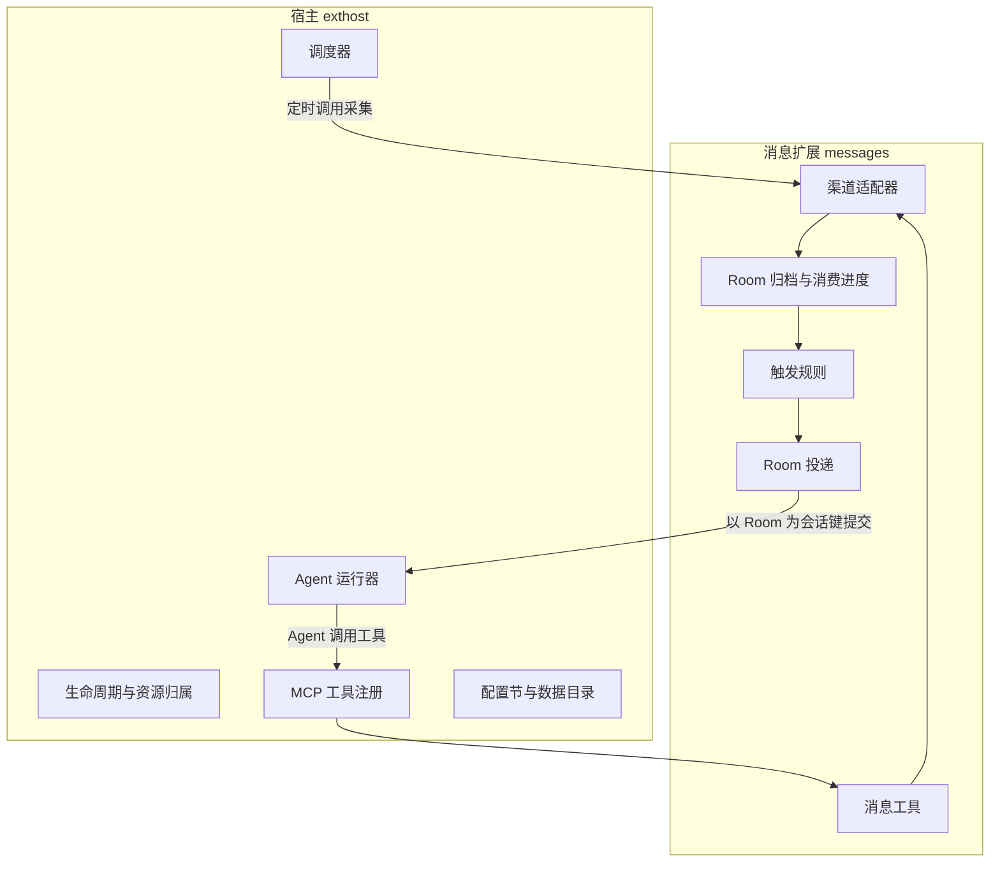

# aicat 消息扩展与宿主扩展契约设计草案

状态：待评审，尚未实现。本文定义两层契约：宿主向扩展提供的通用扩展点，以及“消息”扩展内部的渠道与 Room 契约。`CONTEXT.md` 与 Feature map 在评审通过并实现后再同步。

## 目标与来源

对接各渠道的消息，以 Room 为维度驱动 Agent，并且整套能力按需启用：用户开启扩展后才注册采集任务、MCP 工具和 Agent 处理能力，关闭即停止并撤销，默认不加载。

```text
启用扩展 → 注册定时采集 → 读取渠道消息 → 落盘并提交消费进度
        → 按规则选出 Room → 向该 Room 的 Agent 会话投递 → Agent 调用 MCP 工具回复
```

已确定的输入：

- 扩展点为“请求响应改写、定时任务、MCP 能力”三项，由 aicat 提供，扩展在这三处注入。
- [扩展包草案](extension-packages-design.md) 约定统一展示扩展列表，内置 Go 能力与社区 JS 包可以使用不同的运行机制。
- `codex/wecom-codex` worktree 的原型已实现企微读写、触发、Codex 驱动、定时任务和 MCP 工具，但由 `internal/app/runtime.go` 在启动时直接装配，定时任务结构绑定了 `Account`、`Room`、`Prompt`。

消息扩展用得上三项里的两项（定时任务、MCP 能力），另外需要三样现有扩展点没有的东西：运行中启停的生命周期、扩展自己的持久存储、向 Agent 投递任务的入口。本文把它们补进宿主契约。

## 分层



| 层 | 职责 | 不负责 |
| --- | --- | --- |
| 宿主 `internal/exthost`（拟新增） | 启停、调度、工具注册与撤销、配置节、数据目录、Agent 运行器 | 任何消息语义 |
| 消息扩展 `internal/messages` | 账号、渠道适配、归档、触发、Room 到会话的映射、回发工具 | 进程托管、调度实现、MCP 协议适配 |
| 渠道适配器 `internal/messages/<kind>` | 单个平台的读取、会话资料、发送 | 触发判断、Agent、跨渠道逻辑 |

依赖方向保持单向：`app` 装配宿主并注册内置扩展；扩展只依赖宿主接口；宿主不导入任何扩展；业务包继续不依赖 MyGo、`config` 和 HTTP handler。

## 宿主扩展契约

### 生命周期与资源归属

内置扩展以 Go 注册，声明自己的 ID、展示信息和 `contributes`，并提供一个启用入口。下面是契约形状，名称在实现时定稿：

```go
type Extension struct {
    ID          string       // messages
    Contributes Contributes  // 声明要用的扩展点，用于展示和冲突检查
    Activate    func(ctx context.Context, h Host) error
}

type Host interface {
    Config() ConfigSection      // aicat.yaml 中属于本扩展的节，原子更新
    DataDir() string            // Home/data/<短名>/，0700
    Actions() ActionRegistry    // 具名处理器
    Schedules() Scheduler       // 定时任务
    Tools() ToolRegistry        // MCP 工具
    Agents() AgentRunner        // Agent 投递
    OnDispose(func(context.Context) error)
}
```

- **启用**：宿主调用 `Activate`。返回错误视为启用失败，宿主撤销它已注册的全部资源，状态显示错误原因，开关保持用户意图。
- **归属**：经 `Host` 注册的处理器、定时任务、工具和 Agent 任务都记在该扩展 ID 下，扩展不需要自己记账。
- **停用**：按固定顺序执行：停止新的调度触发和工具调用 → 取消 `ctx` → 在有界时间内等待运行中的处理器结束 → 执行 `OnDispose` → 撤销工具并通知已连接的 MCP 客户端。
- **运行中生效**：启停不需要重启，与流量开关一致；改写规则仍按原草案保存后重启生效。这是两种不同的生效模型，扩展详情分别说明。
- **停用不等于回滚**：已经发出的外部动作（消息、Agent 任务）不撤回；运行中的 Agent 任务标记为中断，不自动重放。
- **状态**：未启用、启用中、运行、停用中、错误五种，UI 与 MCP 读取同一份。

### 处理器

扩展注册具名处理器，调度器和工具都通过名字调用它，这样持久化的任务定义里只需要保存名字和输入。

```go
type Call struct {
    RunID string           // 稳定，同一次触发重试不变
    Input json.RawMessage
}
type Action func(ctx context.Context, c Call) (json.RawMessage, error)
```

处理器必须可取消；名字在扩展内唯一，对外以 `<扩展短名>.<名字>` 标识，例如 `messages.collect`。

### 定时任务

对应三项扩展点里的“注册定时任务”。按是否持久分两类，语义不同，不混用：

| | 间隔任务 | 持久任务 |
| --- | --- | --- |
| 用途 | 高频、可丢弃的轮询，如每秒采集 | 用户或 Agent 创建的一次性或周期任务，如“明天九点提醒” |
| 定义位置 | 扩展代码里声明，不进配置 | `aicat.yaml` 中属于该扩展的节 |
| 进度 | 只在内存 | 存在数据目录，重启恢复 |
| 错过的周期 | 不补 | 多个周期只补一次 |
| 修改 | 随扩展启停 | 带 `expectedRevision`，避免覆盖并发修改 |

共同约束：

- 同一任务不重叠执行，上一轮结束后再安排下一轮。
- 每次触发有稳定的 `RunID`；持久任务在“入队”和“进度更新”之间重启不会重复触发。
- 所属扩展停用期间暂停，恢复后再处理到期任务。
- 时间必须带时区偏移；首版只支持 `at` 和 `every`，不做 cron。
- 间隔下限 1 秒，持久任务周期下限 1 分钟。
- 任务目标是处理器名加输入，宿主不理解 `account`、`room`、`prompt` 这些字段，由扩展解释。

原型的 `tasks.Job{Account, Room, Prompt}` 相应改为“处理器 `messages.dispatch` + 输入 `{account, room, prompt}`”。

### MCP 工具

对应三项扩展点里的“注册 MCP 能力”。

- 扩展注册工具名、说明、输入 schema、只读/破坏性/开放世界标注和处理器；宿主负责协议适配、输入校验、认证和 Origin 拒绝，沿用现有 `/mcp`。
- 工具名必须以扩展声明的前缀开头（消息扩展为 `messages_`），与已有工具或其他扩展冲突时拒绝启用。
- 扩展停用时宿主移除工具并发送工具列表变更通知。当前使用的 MCP Go SDK v1.8.0 提供 `Server.RemoveTools` 和相应通知，这一点已核对源码。
- 工具调用与停用并发时：已开始的调用在有界时间内完成，新调用返回“扩展未启用”。

### 配置与存储

- 开关与设置按 [扩展规范](extension-standard.md) 写在 `aicat.yaml` 的 `extensions.messages` 节：`enabled` 是开关，缺省关闭，账号与触发等设置放在同一节，仍是唯一行为配置。扩展通过 `ConfigSection` 读取和原子更新自己的节，不导入 `config`。
- 运行数据写在 `Home/data/<短名>/`，目录 0700、文件 0600。凭据不进 YAML，只保存绝对路径。
- 宿主提供原子写文件的辅助（原型的 `internal/statefile`）。“归档、去重标识、消费进度一起提交”这类一致性由扩展自己保证，宿主不提供事务。

### Agent 运行器

这是三项扩展点之外新增的宿主能力。理由：定时任务和未来的其他入口同样需要驱动 Agent，而“为 Agent 提供入口”正是网关的定位；放在消息扩展里，第二个入口出现时就得重复一遍进程托管。

```go
type Run struct {
    ID           string           // 稳定任务 ID，重复提交幂等
    Session      string           // 会话键，由提交方定义
    Workdir      string
    Instructions string           // 提交方的开发者指令，追加在宿主内置安全指令之后
    Input        json.RawMessage
}
type AgentRunner interface {
    Submit(ctx context.Context, r Run) error
    Status(ctx context.Context, session string) ([]RunStatus, error)
}
```

- **会话**：同一 `Session` 复用同一个 Agent 原生会话（Codex 的 thread），映射由运行器持久保存，重启后继续。
- **顺序与并发**：同一会话串行；不同会话并发，上限缺省 4。
- **运行中追加**：会话正在执行时又收到提交，运行器支持追加就并入当前轮（Codex 的 `turn/steer`），追加前先持久预留；不支持或被拒绝则排到下一轮。
- **状态**：排队、运行、完成、失败、中断、结果不明。中断和结果不明都不自动重放。
- **工具访问**：运行器把 aicat 的 MCP 地址和 token 通过子进程环境交给 Agent，不进命令行参数。
- **按需启动**：没有扩展提交任务时不启动任何 Agent 进程。
- **实现**：运行器是接口，首个实现是 Codex app-server（原型已验证）。其他 Agent 以新的实现接入，不改提交方。

不由 aicat 托管的 Agent 仍可使用消息能力：它连接同一个 `/mcp`，用 `messages_read` 自己管理 cursor 拉取、用 `messages_send` 回复。这条路径没有触发和 Room 会话，由 Agent 自己决定何时处理。

### 与扩展包声明的对应

宿主扩展点与 `contributes` 一一对应，内置扩展用 Go 声明同样的信息，供扩展页展示：

| 扩展点 | `contributes` 字段 | 首版谁能用 |
| --- | --- | --- |
| 请求响应改写 | `rewrite` | 社区 JS 包、本地脚本 |
| 定时任务 | `schedules` | 内置 Go 扩展 |
| MCP 工具 | `mcp.tools` | 内置 Go 扩展 |
| Agent 投递 | `agent` | 内置 Go 扩展 |

社区 JS 包使用 `schedules` 和 `mcp.tools` 需要先解决 moejs 每次调用独立 runtime、没有持久状态的问题，不在本文范围。

## 消息扩展契约

### 账号与渠道

一个账号是“某个渠道上的一个登录身份”，由用户起稳定的 `id`，不从渠道账号或路径推导。渠道以 Go 适配器实现并编译进二进制：

```go
type Channel interface {
    Kind() string                 // wecom-local
    Capabilities() Capabilities   // 文本、图片、文件、@、引用、能否发送
    Open(ctx context.Context, settings json.RawMessage) (Account, error)
}
type Account interface {
    Identity(ctx context.Context) (string, error)   // 渠道内稳定账号 ID，用于判断消息是否自己发出
    Tail(ctx context.Context) (cursor string, err error)
    Read(ctx context.Context, cursor string) (Batch, error)
    Rooms(ctx context.Context, after string, limit int) (Rooms, string, error)
    Send(ctx context.Context, out Outbound) (Receipt, error)
    Close() error
}
```

- **读取**：按顺序返回消息和不透明 cursor；失败不推进 cursor；每批有上限。
- **推送型平台**（长连接、长轮询）也实现同一个 `Read`：适配器把收到的事件先写进自己的持久缓冲，再按 cursor 读出。扩展上层只面对一种读取方式。
- **发送**：必须带 `requestId`。先记录尝试再执行；同 ID 同内容返回原回执，同 ID 不同内容报错；结果不确定时如实返回，不自动重发。
- **能力声明**：不支持的操作在调用前按能力拒绝，不靠运行时报错猜测。

### 统一消息

沿用企业微信会话存档的字段形状作为基准，各渠道适配器负责转换。上层只依赖下列字段，其余字段原样透传给 Agent：

| 字段 | 含义 |
| --- | --- |
| `msgid` | 账号内唯一，用于去重和任务 ID |
| `roomid` | 渠道内稳定的会话标识，私聊和群聊统一 |
| `from` | 发送者在渠道内的稳定 ID |
| `msgtime` | 毫秒时间戳 |
| `msgtype` | `text`、`reply`、`image`、`file` 等 |
| `outgoing` | 是否当前账号发出 |
| `mentions` | 被 @ 的对象 |

每批附带本批涉及的会话资料与用户资料（类型、名称、备注），资料解析失败时本批不推进。

### Room

Room 是整套能力的唯一维度，键为“账号 `id` + `roomid`”。下列事物都以 Room 为单位：

| 事物 | 以 Room 为单位的含义 |
| --- | --- |
| 归档 | 每个 Room 一份只追加的消息记录 |
| 排队 | 同一 Room 的任务串行，不同 Room 互不合并 |
| Agent 会话 | Room 键即运行器的 `Session`，一个 Room 对应一个长期会话 |
| 工作目录 | 每个 Room 独立，可由配置指到已有项目 |
| 回复目标 | Agent 回发时显式给出账号和 Room |
| 定时任务 | 持久任务的输入指定账号和 Room |

消息、会话资料和历史始终是不可信的用户输入，不提升为系统或开发者指令。

### 采集、归档与触发

采集由间隔任务调用处理器 `messages.collect` 完成，每个启用读取的账号一轮：

1. 首次启用以渠道当前末尾为起点，不回溯历史。关闭再启用同样从当前末尾开始，关闭期间的消息不补跑。
2. 读取一批，按 Room 追加到归档。
3. 对每条消息判断触发，把命中的整理成待投递任务。
4. 归档、待投递任务和 cursor 一起提交；提交失败则本批整体不推进。
5. 提交成功后才向运行器 `Submit`。

触发规则沿用原型语义，可按账号覆盖：

- `chat`：对方发来的私聊，或群聊里 @ 当前账号。不限消息类型，私聊发来的图片或文件也会触发。
- `regex`：匹配 `text` 的正文或 `reply` 的标题；`self` 为真时才对自己发出的消息生效。
- 距当前超过 10 分钟或时间缺失的消息只归档不触发。
- aicat 自己发出的消息按发送回执排除，避免回复循环。

同一 Room 一批内多条命中合并为一次投递；Room 正在执行时由运行器按“运行中追加”处理。

### 投递与回复

投递任务的 ID 为 `message/<账号>/<msgid>`，定时任务触发的为调度器给出的 `RunID`。输入只包含触发消息、相关资料和当前时间；历史上下文由 Agent 按需通过工具读取。

Agent 必须调用 `messages_send` 回复，`requestId` 用 `<任务 ID>/reply/<序号>`；编排层不转发 Agent 的文本输出。任务结束时没有回执标为“未回复”，回执不确定标为“回复不明”，两者都不自动补发。

### 工具

沿用原型的工具集，全部在扩展启用后才出现：

| 工具 | 用途 |
| --- | --- |
| `messages_guide` | 调用约定 |
| `messages_accounts` | 账号、渠道、读写开关 |
| `messages_rooms` | Room 分页、稳定 ID 和名称 |
| `messages_read` | 以调用者自己的 cursor 读取消息，不影响自动化消费进度 |
| `messages_send` | 发送文本或图片 |
| `messages_runs` | Room 的任务与回发状态（原 `agent_status`） |
| `messages_jobs_list` / `_put` / `_delete` | 定时任务（原 `tasks_*`） |

定时任务工具由消息扩展持有而不是宿主通用提供：输入限定为账号、Room 和提示词，Agent 不能借它调度任意处理器。

### 配置

```yaml
extensions:
  messages:
    enabled: true          # 扩展总开关，缺省 false
    accounts:
      - id: work-wecom
        channel: wecom-local
        read: true
        send: true
        settings:            # 由渠道适配器解释
          accountID: "123456789"
          dataDir: /absolute/path/to/account/database
          keyFile: /absolute/path/to/keys.json
    dispatch:
      enabled: true          # 自动触发子开关；关闭后只保留读取和工具
      agent: codex
      trigger:
        chat: true
        regex: '^虾虾'
        self: false
    jobs: []                 # 持久定时任务
agents:
  codex:                   # 运行器设置，属于宿主
    binary: /absolute/path/to/codex
```

读取、发送、自动触发三者独立启停：只开读取时 Agent 可以查消息但 aicat 不会自动驱动，也不会发出任何消息。

### 界面

内置扩展的页面随应用编译，不走社区扩展的通用详情区。

- 扩展列表新增内置条目“消息”，详情里是总开关、账号的读写开关、自动触发开关和运行状态。
- 启用后在“更多”中出现“消息”模块，可固定到导航栏：侧边栏按账号列出 Room，主面板是该 Room 的消息与任务状态。
- 停用后隐藏模块入口；用户正停在该模块时回到扩展详情。

界面细节另行出设计稿，不属于本契约。

## 原型迁移对应

| 原型（`codex/wecom-codex`） | 迁入后 |
| --- | --- |
| `internal/app/runtime.go` 直接装配 | `app` 只注册内置扩展，装配移入 `Activate` |
| `internal/messages` 的 `Service` 与 `wecom`、`desktop` | 保留；`wecom` 收为渠道适配器 `wecom-local` |
| `internal/agent/poll.go` 轮询 | 处理器 `messages.collect` + 间隔任务 |
| `internal/agent/trigger.go` | 移入消息扩展，改依赖统一消息字段而不是 `wecom.Message` |
| `internal/agent` 的队列、`codex.go`、`worker.go` | 宿主 Agent 运行器及其 Codex 实现 |
| `internal/tasks` | 宿主调度器的持久任务；`Job` 改为处理器名加输入 |
| `internal/mcpserver/messages.go` | 经 `ToolRegistry` 注册，随扩展启停 |
| 顶层配置 `messages`、`agent`、`tasks` | `extensions.messages`、`agents` |
| 归档 | 原型没有，随迁入补齐 |

## 需要覆盖的失败方式

实现前先列出，逐项用隔离 Home 和合成渠道数据验证：

- 启用中途失败，留下半注册的工具或任务。
- 停用时仍有采集、发送或工具调用在执行；停用后工具仍可见或仍被调用成功。
- 归档成功但 cursor 未提交，或反过来，导致漏消息或重复触发。
- 进程在投递前后退出，重启后重复投递或丢失任务。
- 运行中追加的确认丢失，同一消息被处理两次。
- 发送结果不确定时被当成失败重发。
- 自己发出的回复再次命中触发，形成循环。
- 历史消息在首次启用或同步时触发任务。
- 持久任务在重启、错过多个周期、并发修改时重复或丢失。
- Agent 借定时任务工具调度到非本扩展的处理器，或向不属于该账号的 Room 发送。
- 关闭自动触发后仍有任务被提交；关闭发送后仍发出消息。
- Agent 进程异常退出被当成任务完成。

## 实施顺序

1. 宿主：`internal/exthost` 的生命周期、处理器、调度器、工具注册和配置节，把现有流量开关接到同一生命周期上验证启停。
2. 消息只读：迁入 `messages` 与 `wecom-local`，接上 `messages_accounts`、`messages_rooms`、`messages_read`，验证启用后出现、停用后撤销。
3. 发送与归档：`messages_send`、回执、Room 归档和采集任务。
4. Agent 运行器与 Room 投递：迁入 Codex 实现、触发规则、运行中追加和定时任务工具。
5. 界面：扩展详情与消息模块。

每步只验证受影响的场景，整轮完成后统一验收。

## 待确认

下面四项影响范围，本文按推荐项撰写，改动任何一项都需要相应调整上文。

1. **Agent 运行器归宿主**（推荐），还是留在消息扩展里。归宿主时定时任务和后续入口可以复用，但宿主多了一块进程托管职责。
2. **平台渠道首版只做内置 Go 适配器**（推荐），社区包的 `contributes.channel` 等有了可长期运行的扩展运行时再开放。企微本地读取依赖 cgo 和本机脚本，无法放进现有 moejs 沙箱。
3. **一个“消息”扩展加自动触发子开关**（推荐），而不是原型里“企微消息”和“Agent 自动化”两个并列的总开关。后者依赖前者，拆成两个扩展需要引入扩展间依赖。
4. **`messages_read` 的历史范围**：渠道自带本地历史的（企微本地库）继续直接读渠道，可查启用前的消息（推荐）；还是统一只读归档，各渠道行为一致但查不到启用前的历史。
