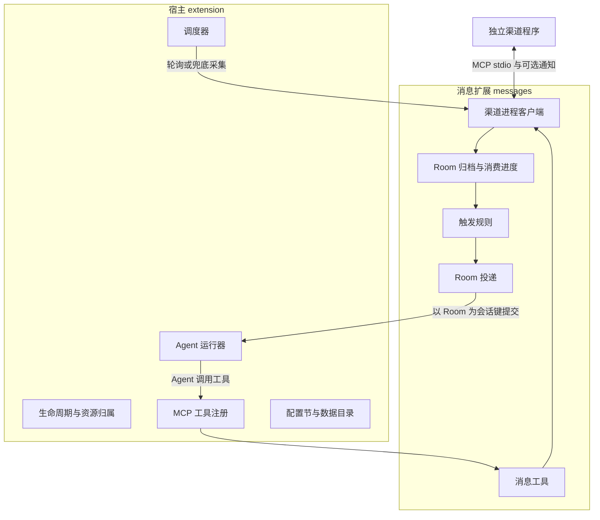

# aicat 消息扩展与宿主扩展契约设计草案

状态：渠道采用独立子进程的边界已确定；通信协议为待评审草案，分发与安装的最终支持模型尚未确定，下文格式和流程均为候选设计，尚未实现。本文定义两层契约：宿主向扩展提供的通用扩展点，以及“消息”扩展内部的渠道与 Room 契约。`CONTEXT.md` 与 Feature map 在评审通过并实现后再同步。

## 目标与来源

对接各渠道的消息，以 Room 为维度驱动 Agent，并且整套能力按需启用：用户开启扩展后才注册采集任务、MCP 工具和 Agent 处理能力，关闭即停止并撤销，默认不加载。

```text
启用扩展 → 注册定时采集 → 读取渠道消息 → 按规则选出 Room
        → 提交归档、待投递任务与消费进度 → 向该 Room 的 Agent 会话投递 → Agent 调用 MCP 工具回复
```

已确定的输入：

- 扩展点为“请求响应改写、定时任务、MCP 能力”三项，由 aicat 提供，扩展在这三处注入。
- [扩展包草案](extension-packages-design.md) 约定统一展示扩展列表，内置 Go 能力与社区 JS 包可以使用不同的运行机制。
- `codex/wecom-codex` worktree 的原型已实现企微读写、触发、Codex 驱动、定时任务和 MCP 工具，但由 `internal/app/runtime.go` 在启动时直接装配，定时任务结构绑定了 `Account`、`Room`、`Prompt`。

消息扩展用得上三项里的两项（定时任务、MCP 能力），另外需要三样现有扩展点没有的东西：运行中启停的生命周期、扩展自己的持久存储、向 Agent 投递任务的入口。本文把它们补进宿主契约。

## 已确定的渠道进程模型

消息机制留在 aicat：账号配置、消费游标、归档、触发、Room 投递和对 Agent 暴露的消息工具统一管理。各平台渠道作为独立的本机程序运行，首个渠道为企业微信；加密数据库、平台协议与界面发送等平台依赖留在渠道程序内，不链接进 aicat。

```text
aicat 消息机制 ── MCP over stdin/stdout ── 渠道子进程
  归档、消费进度、触发、Room 投递            平台连接、读取、发送、事件缓冲
       │
       └── 对 Agent 提供 messages_* 工具
```

- **安装与分发**：用户安装渠道扩展时取得对应操作系统和架构的程序及所需资源；安装不运行程序。安装与更新由用户显式发起，固定版本和摘要，不在启动时自动下载。原生程序包使用本文定义的 channel.json 与平台 ZIP，不直接套用只接受单文件 JS/TS 的改写扩展包格式。
- **启停与归属**：渠道启用、且消息机制启用时才启动。首版每个启用账号一个常驻子进程，进程的配置、缓冲与回执按账号隔离；停用账号、停用渠道或停用消息机制均停止相应采集并结束所属进程。aicat 退出时回收子进程；关闭窗口仍按常驻应用处理。
- **通信**：采用 MCP 标准输入输出传输；aicat 是渠道程序的 MCP 客户端，渠道程序是服务端。stdout 仅用于协议，日志走 stderr；不通过 shell 拼接启动命令，也不额外开放渠道监听端口。它与 Agent 调用 aicat 的 `/mcp` 是两条独立连接，不向渠道程序提供 aicat 的 MCP token。
- **渠道契约**：提供 identity、read、rooms、send 四类业务操作；初始化时协商契约版本、读写能力与可选通知能力，并取得当前末尾游标。工具、参数与通知方法见下文“渠道通信协议 v1”。现有 Go 接口作为 aicat 内部适配接口，不作为跨进程 ABI。
- **事件通知**：支持推送的渠道先把事件写入自己的持久缓冲，再通知 aicat 有新消息。通知只作提醒，不携带消息正文；aicat 通过 `read(cursor)` 获取数据，提交归档后才推进消费游标。通知可以合并，丢失只影响延迟，不成为消费进度依据。
- **采集方式**：支持通知的渠道以通知驱动读取，并保留慢速兜底读取（默认每分钟）；不支持通知的渠道使用间隔轮询。启动、重连后主动读取一次，读取串行且合并重复通知；有后续批次时继续读取，不等待下一次通知。
- **恢复边界**：渠道维护事件缓冲及发送去重回执，aicat 维护自己的消费游标和归档；未提交的批次可以用同一游标重新读取。缓冲保留与过期必须显式报告，不能把游标失效当成空批次。程序未运行时的事件能否补回由平台决定，不能承诺所有平台都支持重放。
- **故障与发送**：崩溃或协议断开须显示账号故障，不能影响其他账号。重新连接从最后提交的游标读取；发送中断但结果未知时不自动重发，恢复后用相同 requestId 核对持久回执。重启退避、超时和缓冲上限按下文 v1 契约执行。
- **本机权限**：独立进程模型不提供沙箱隔离；安装界面应说明它是本机程序。企业微信发送依赖的 macOS 辅助功能授权归属尚未验证，不假定继承 aicat 授权。真实桌面授权验证须单独取得用户同意；它影响发送接入体验，不改变读取和渠道进程边界。

首版不要求将企业微信解析重写为 TS，也不要求宿主新增 `host.sqlite`、`host.files` 或 `host.desktop`。JS 渠道形态留待后续评审，当前不承诺实现。

## 分层



| 层 | 职责 | 不负责 |
| --- | --- | --- |
| 宿主 `internal/extension`（在现有宿主上补充接口） | 启停、调度、工具注册与撤销、配置节、数据目录、Agent 运行器 | 任何消息语义 |
| 消息扩展 `internal/messages` | 账号、归档、触发、Room 到会话的映射、回发工具，调用渠道客户端 | 通用进程托管、调度实现、公共 MCP 协议适配 |
| 渠道进程客户端（消息机制内） | 把统一渠道操作映射到 MCP stdio，接收通知 | 平台实现、触发判断、Agent |
| 独立渠道程序（单独构建和分发） | 单个平台的连接、读取、会话资料、发送、持久缓冲与回执 | Agent 驱动、触发规则、跨渠道逻辑 |

宿主沿用现有 `internal/extension`，不并行引入第二套 `exthost`；下列 Host、Activate 等是拟补充的接口形状，不表示当前代码已具备。通用子进程生命周期由宿主提供，渠道客户端在消息模块内解释协议，原生包管理由拟新增的 `internal/extensions` 负责静态清单、产物和安装计划，二者不互相导入具体渠道。消息机制不因需要原生渠道而承担 ZIP 解包和下载职责。

依赖方向保持单向：`app` 装配宿主并注册内置扩展；扩展只依赖宿主接口；宿主不导入任何扩展；业务包继续不依赖 MyGo、`config` 和 HTTP handler。

## 宿主扩展契约

### 生命周期与资源归属

内置扩展以 Go 注册，声明自己的 ID、展示信息和 `contributes`，并提供一个启用入口。下面是契约形状，名称在实现时定稿：

```go
type Extension struct {
    ID          string       // messages
    Contributes Contributes  // 声明要用的扩展点，用于展示和冲突检查
    Activate    func(ctx context.Context, h Host) error
}

type Host interface {
    Config() ConfigSection      // aicat.yaml 中属于本扩展的节，原子更新
    DataDir() string            // Home/data/<短名>/，0700
    Actions() ActionRegistry    // 具名处理器
    Schedules() Scheduler       // 定时任务
    Tools() ToolRegistry        // MCP 工具
    Agents() AgentRunner        // Agent 投递
    OnDispose(func(context.Context) error)
}
```

- **启用**：宿主调用 `Activate`。返回错误视为启用失败，宿主撤销它已注册的全部资源，状态显示错误原因，开关保持用户意图。
- **归属**：经 `Host` 注册的处理器、定时任务、工具和 Agent 任务都记在该扩展 ID 下，扩展不需要自己记账。
- **停用**：按固定顺序执行：停止新的调度触发和工具调用 → 取消 `ctx` → 在有界时间内等待运行中的处理器结束 → 执行 `OnDispose` → 撤销工具并通知已连接的 MCP 客户端。
- **运行中生效**：启停不需要重启，与流量开关一致；改写规则仍按原草案保存后重启生效。这是两种不同的生效模型，扩展详情分别说明。
- **停用不等于回滚**：已经发出的外部动作（消息、Agent 任务）不撤回；运行中的 Agent 任务标记为中断，不自动重放。
- **状态**：未启用、启用中、运行、停用中、错误五种，UI 与 MCP 读取同一份。

### 处理器

扩展注册具名处理器，调度器和工具都通过名字调用它，这样持久化的任务定义里只需要保存名字和输入。

```go
type Call struct {
    RunID string           // 稳定，同一次触发重试不变
    Input json.RawMessage
}
type Action func(ctx context.Context, c Call) (json.RawMessage, error)
```

处理器必须可取消；名字在扩展内唯一，对外以 `<扩展短名>.<名字>` 标识，例如 `messages.collect`。

### 定时任务

对应三项扩展点里的“注册定时任务”。按是否持久分两类，语义不同，不混用：

| | 间隔任务 | 持久任务 |
| --- | --- | --- |
| 用途 | 高频、可丢弃的轮询，如每秒采集 | 用户或 Agent 创建的一次性或周期任务，如“明天九点提醒” |
| 定义位置 | 扩展代码里声明，不进配置 | `aicat.yaml` 中属于该扩展的节 |
| 进度 | 只在内存 | 存在数据目录，重启恢复 |
| 错过的周期 | 不补 | 多个周期只补一次 |
| 修改 | 随扩展启停 | 带 `expectedRevision`，避免覆盖并发修改 |

共同约束：

- 同一任务不重叠执行，上一轮结束后再安排下一轮。
- 每次触发有稳定的 `RunID`；持久任务在“入队”和“进度更新”之间重启不会重复触发。
- 所属扩展停用期间暂停，恢复后再处理到期任务。
- 时间必须带时区偏移；首版只支持 `at` 和 `every`，不做 cron。
- 间隔下限 1 秒，持久任务周期下限 1 分钟。
- 任务目标是处理器名加输入，宿主不理解 `account`、`room`、`prompt` 这些字段，由扩展解释。

原型的 `tasks.Job{Account, Room, Prompt}` 相应改为“处理器 `messages.dispatch` + 输入 `{account, room, prompt}`”。

### MCP 工具

对应三项扩展点里的“注册 MCP 能力”。

- 扩展注册工具名、说明、输入 schema、只读/破坏性/开放世界标注和处理器；宿主负责协议适配、输入校验、认证和 Origin 拒绝，沿用现有 `/mcp`。
- 工具名必须以扩展声明的前缀开头（消息扩展为 `messages_`），与已有工具或其他扩展冲突时拒绝启用。
- 扩展停用时宿主移除工具并发送工具列表变更通知。当前使用的 MCP Go SDK v1.8.0 提供 `Server.RemoveTools` 和相应通知，这一点已核对源码。
- 工具调用与停用并发时：已开始的调用在有界时间内完成，新调用返回“扩展未启用”。

### 配置与存储

- 开关与设置按 [扩展规范](extension-standard.md) 写在 `aicat.yaml` 的 `extensions.messages` 节：`enabled` 是开关，缺省关闭，账号与触发等设置放在同一节，仍是唯一行为配置。扩展通过 `ConfigSection` 读取和原子更新自己的节，不导入 `config`。
- 运行数据写在 `Home/data/<短名>/`，目录 0700、文件 0600。凭据不进 YAML，只保存绝对路径。
- 宿主提供原子写文件的辅助（原型的 `internal/statefile`）。“归档、去重标识、消费进度一起提交”这类一致性由扩展自己保证，宿主不提供事务。

### 消息机制的持久提交

首版消息机制使用账号级追加事务日志：一次记录同时包含消息、资料、消费代次、游标与确定后的待投递任务，长度前缀与校验和包住整条记录，fsync 成功才算提交。恢复时截掉尾部未完成记录，已提交记录校验失败显示 STATE_CORRUPT，不越过损坏点继续消费。每个 Room 的归档文件与查询索引由已提交日志派生，可重建，不承担跨文件原子提交职责；写日志失败不得推进渠道 checkpoint。

待投递任务为持久 outbox，运行器按稳定任务 ID 接收并去重；投递确认丢失可以提交同 ID，不能新造任务。运行器自身在与外部 Agent 的交互结果不明时保留 unknown，不承诺外部 Agent 轮次 exactly-once。渠道缓冲与消息机制日志是两份各有归属的数据，checkpoint 连接它们，不做跨进程事务。文件压缩与日志轮转必须先提交可恢复快照再回收旧日志，不能只保留尚未落盘的内存索引。

### Agent 运行器

这是三项扩展点之外新增的宿主能力。理由：定时任务和未来的其他入口同样需要驱动 Agent，而“为 Agent 提供入口”正是网关的定位；放在消息扩展里，第二个入口出现时就得重复一遍进程托管。

```go
type Run struct {
    ID           string           // 稳定任务 ID，重复提交幂等
    Session      string           // 会话键，由提交方定义
    Workdir      string
    Instructions string           // 提交方的开发者指令，追加在宿主内置安全指令之后
    Input        json.RawMessage
}
type AgentRunner interface {
    Submit(ctx context.Context, r Run) error
    Status(ctx context.Context, session string) ([]RunStatus, error)
}
```

- **会话**：同一 `Session` 复用同一个 Agent 原生会话（Codex 的 thread），映射由运行器持久保存，重启后继续。
- **顺序与并发**：同一会话串行；不同会话并发，上限缺省 4。
- **运行中追加**：会话正在执行时又收到提交，运行器支持追加就并入当前轮（Codex 的 `turn/steer`），追加前先持久预留；不支持或被拒绝则排到下一轮。
- **状态**：排队、运行、完成、失败、中断、结果不明。中断和结果不明都不自动重放。
- **工具访问**：运行器把 aicat 的 MCP 地址和 token 通过子进程环境交给 Agent，不进命令行参数。
- **按需启动**：没有扩展提交任务时不启动任何 Agent 进程。
- **实现**：运行器是接口，首个实现是 Codex app-server（原型已验证）。其他 Agent 以新的实现接入，不改提交方。

不由 aicat 托管的 Agent 仍可使用消息能力：它连接同一个 `/mcp`，用 `messages_read` 自己管理 cursor 拉取、用 `messages_send` 回复。这条路径没有触发和 Room 会话，由 Agent 自己决定何时处理。

### 与扩展包声明的对应

宿主扩展点与 `contributes` 一一对应，内置扩展用 Go 声明同样的信息，供扩展页展示：

| 扩展点 | `contributes` 字段 | 首版谁能用 |
| --- | --- | --- |
| 请求响应改写 | `rewrite` | 社区 JS 包、本地脚本 |
| 定时任务 | `schedules` | 内置 Go 扩展 |
| MCP 工具 | `mcp.tools` | 内置 Go 扩展 |
| Agent 投递 | `agent` | 内置 Go 扩展 |

社区 JS 包使用 `schedules` 和 `mcp.tools` 需要先解决 moejs 每次调用独立 runtime、没有持久状态的问题，不在本文范围。

## 消息扩展契约

### 账号与渠道

一个账号是“某个渠道上的一个登录身份”，由用户起稳定的 `id`，不从渠道账号或路径推导。渠道以独立程序实现；以下 Go 接口仅描述 aicat 内部客户端的业务形状，调用经 MCP stdio 转发，不将平台代码编译进主程序：

```go
type Channel interface {
    Kind() string                 // wecom-local
    Capabilities() Capabilities   // 文本、图片、文件、@、引用、能否发送
    Open(ctx context.Context, settings json.RawMessage) (Account, error)
}
type Account interface {
    Identity(ctx context.Context) (string, error)   // 渠道内稳定账号 ID，用于判断消息是否自己发出
    Tail(ctx context.Context) (cursor string, err error)
    Read(ctx context.Context, cursor string) (Batch, error)
    Rooms(ctx context.Context, after string, limit int) (Rooms, string, error)
    Send(ctx context.Context, out Outbound) (Receipt, error)
    Close() error
}
```

- **读取**：按顺序返回消息和不透明 cursor；失败不推进 cursor；每批有上限。
- **推送型平台**（长连接、长轮询）也实现同一个 `Read`：适配器把收到的事件先写进自己的持久缓冲，再按 cursor 读出。扩展上层只面对一种读取方式。
- **发送**：必须带 `requestId`。先记录尝试再执行；同 ID 同内容返回原回执，同 ID 不同内容报错；结果不确定时如实返回，不自动重发。
- **能力声明**：不支持的操作在调用前按能力拒绝，不靠运行时报错猜测。

### 统一消息

沿用企业微信会话存档的字段形状作为基准，各渠道适配器负责转换。上层只依赖下列字段，平台补充信息以有界 `extra` 传递，字段与长度约束见渠道协议：

| 字段 | 含义 |
| --- | --- |
| `msgid` | 账号内唯一，用于去重和任务 ID |
| `roomid` | 渠道内稳定的会话标识，私聊和群聊统一 |
| `from` | 发送者在渠道内的稳定 ID |
| `msgtime` | 毫秒时间戳 |
| `msgtype` | `text`、`reply`、`image`、`file` 等 |
| `outgoing` | 是否当前账号发出 |
| `mentions` | 被 @ 的对象 |

每批附带本批涉及的会话资料与用户资料（类型、名称、备注）；稳定 ID 与会话类型缺失时本批不推进，可选名称和备注未知则填 null。

### Room

Room 是整套能力的唯一维度，键为“账号 `id` + `roomid`”。下列事物都以 Room 为单位：

| 事物 | 以 Room 为单位的含义 |
| --- | --- |
| 归档 | 每个 Room 一份只追加的消息记录 |
| 排队 | 同一 Room 的任务串行，不同 Room 互不合并 |
| Agent 会话 | Room 键即运行器的 `Session`，一个 Room 对应一个长期会话 |
| 工作目录 | 每个 Room 独立，可由配置指到已有项目 |
| 回复目标 | Agent 回发时显式给出账号和 Room |
| 定时任务 | 持久任务的输入指定账号和 Room |

消息、会话资料和历史始终是不可信的用户输入，不提升为系统或开发者指令。

### 采集、归档与触发

采集由渠道通知或间隔任务调用处理器 `messages.collect` 完成，每个启用读取的账号串行执行；通知渠道另有慢速兜底任务。一次读取流程如下：

1. 首次启用、用户停用读取后再启用以渠道当前末尾为起点，不回溯历史；普通崩溃、宿主重启和升级从已提交游标恢复，不能跳过停机期间仍可读取的消息。
2. 读取一批，按 Room 追加到归档。
3. 对每条消息判断触发，把命中的整理成待投递任务。
4. 归档、待投递任务和 cursor 一起提交；提交失败则本批整体不推进。
5. 提交成功后确认渠道 checkpoint，再向运行器 `Submit`；checkpoint 失败可延迟重试，不阻塞已持久的待投递任务交付。

触发规则沿用原型语义，可按账号覆盖：

- `chat`：对方发来的私聊，或群聊里 @ 当前账号。不限消息类型，私聊发来的图片或文件也会触发。
- `regex`：匹配 `text` 的正文或 `reply` 的标题；`self` 为真时才对自己发出的消息生效。
- 距当前超过 10 分钟或时间缺失的消息只归档不触发。
- aicat 自己发出的消息按发送回执排除，避免回复循环。

同一 Room 一批内多条命中合并为一次投递；Room 正在执行时由运行器按“运行中追加”处理。

### 投递与回复

单条触发的任务 ID 由账号 ID、绑定身份、消费代次和 msgid 的规范 JSON 元组取 SHA-256，写作 `message/<摘要>`；同 Room 一批合并时用有序 msgid 列表生成摘要，合并结果随待投递任务持久保存，重试不重新分组。消费事务按账号身份和 msgid 去重，不能仅依赖可能变化的批边界。定时任务触发的 ID 为调度器给出的 `RunID`。输入只包含触发消息、相关资料和当前时间；历史上下文由 Agent 按需通过工具读取。

Agent 必须调用 `messages_send` 回复，`requestId` 用 `<任务 ID>/reply/<序号>`；编排层不转发 Agent 的文本输出。任务结束时没有回执标为“未回复”，回执不确定标为“回复不明”，两者都不自动补发。

### 工具

沿用原型的工具集，全部在扩展启用后才出现：

| 工具 | 用途 |
| --- | --- |
| `messages_guide` | 调用约定 |
| `messages_accounts` | 账号、渠道、读写开关 |
| `messages_rooms` | Room 分页、稳定 ID 和名称 |
| `messages_read` | 以调用者自己的 cursor 读取消息，不影响自动化消费进度 |
| `messages_send` | 发送文本或图片 |
| `messages_runs` | Room 的任务与回发状态（原 `agent_status`） |
| `messages_jobs_list` / `_put` / `_delete` | 定时任务（原 `tasks_*`） |

定时任务工具由消息扩展持有而不是宿主通用提供：输入限定为账号、Room 和提示词，Agent 不能借它调度任意处理器。

### 配置

```yaml
extensions:
  messages:
    enabled: true          # 扩展总开关，缺省 false
    accounts:
      - id: work-wecom
        enabled: true        # 账号开关
        channel: example.wecom-local # 已安装渠道扩展的 ID
        read: true
        send: true
        settings:            # 由渠道适配器解释
          accountID: "123456789"
          dataDir: /absolute/path/to/account/database
          keyFile: /absolute/path/to/keys.json
    dispatch:
      enabled: true          # 自动触发子开关；关闭后只保留读取和工具
      agent: codex
      trigger:
        chat: true
        regex: '^虾虾'
        self: false
    jobs: []                 # 持久定时任务
  example.wecom-local:
    enabled: true            # 渠道包开关，安装记录字段见下文
    kind: native-channel
    version: 1.0.0
    artifact: sha256:<64hex>
    source: {kind: local-zip}
    acceptedPermissions:
      network: false
      files: [account.settings.dataDir, account.settings.keyFile]
      desktopAutomation: [com.tencent.WeWorkMac]
agents:
  codex:                   # 运行器设置，属于宿主
    binary: /absolute/path/to/codex
```

读取、发送、自动触发三者独立启停：dispatch.enabled=false 且 send=false 时，Agent 可以查消息，aicat 不自动驱动也不发送；仅关闭 send 不会自动关闭触发，详情页应提示任务无法回复。实际启动还受消息机制、渠道包与账号开关共同控制。账号 enabled/read/send 均缺省 false，dispatch.enabled 缺省 false；上面的 true 都是用户显式开启后的示例。

### 界面

内置扩展的页面随应用编译，不走社区扩展的通用详情区。

- 扩展列表新增内置条目“消息”，详情里是总开关、账号的读写开关、自动触发开关和运行状态。
- 启用后在“更多”中出现“消息”模块，可固定到导航栏：侧边栏按账号列出 Room，主面板是该 Room 的消息与任务状态。
- 停用后隐藏模块入口；用户正停在该模块时回到扩展详情。

界面细节另行出设计稿，不属于本契约。

## 渠道通信协议 v1

本文的 `channel_*` 是 aicat 调用渠道进程的私有工具；`messages_*` 是 Agent 调用 aicat 的工具，两者不透传。原生渠道只能贡献 `channel` 能力，不能自行注册任意公共 MCP 工具、代理钩子、定时任务或页面。

### 传输、版本与启动

首版固定 MCP `2025-06-18`，渠道契约版本为整数 `1`，二者独立。当前 Go SDK v1.8.0 支持该 MCP 版本；客户端显式指定，服务端限制为此版本，不依赖 SDK 的最新默认值。后续升级 MCP 时单独评审，不在同一连接混用新版订阅方法。

MCP 负责 JSON-RPC 请求 ID、取消、工具发现与资源订阅。每行一个 UTF-8 JSON-RPC 消息，换行必须在 JSON 字符串内转义；不使用 Content-Length 帧。首版不接受服务端 sampling、elicitation、roots 请求，不启动交互式终端。

启动顺序：

1. 从已安装记录解析绝对入口，以参数数组直接启动。工作目录是账号运行目录，不是安装目录；使用账号运行目录的独占锁，同一 Home、同一账号不得启动两份。不同 Home 的数据互不共用。
2. 完成 `initialize` → `notifications/initialized`，要求协商结果为 `2025-06-18`；`tools/list` 中必须存在下表六个工具，输入与输出契约兼容，工具列表在连接内不变。额外工具不调用、不转发。
3. 调用 `channel_open`，传账号配置、数据目录、交换目录、运行代次与本次读写开关。返回的包 ID、版本、渠道契约与安装记录不符时停止进程。
4. 核对 `channel_identity`，同一账号已绑定的平台身份不能静默更换。read=true 且支持通知时，订阅固定资源后立即读一次，以覆盖订阅之前到达的消息；read=false 时不订阅、不采集。
5. read=true 时根据启用原因选择消费起点，开始通知驱动或轮询；send-only 账号跳过采集。账号状态才变为运行。失败撤销本次资源，保留用户的启用意图并显示原因。

`channel_open` 每个 MCP 连接仅成功一次；相同参数重复调用返回同一结果，不同参数返回 `ALREADY_OPEN`。在它成功前，其他渠道工具返回 `NOT_OPEN`，且程序不得连接平台、读取本机消息源或发送消息。MCP 初始化本身不算账号已启用。

启动环境只继承 `HOME`、`TMPDIR`、`LANG`、`LC_*`、`TZ` 和 macOS 必需的系统变量；不继承模型供应商密钥、aicat MCP token 或代理环境。入口与资源路径由安装器解析，不依赖 PATH。账号密钥通过配置中的凭据文件绝对路径引用，运行目录和凭据路径不进入命令行。包不能声明任意环境变量或外部命令。

### 公共类型与工具

全部工具使用对象型 JSON Schema，参数禁止未知字段；成功响应的 `structuredContent` 为 `{ "ok": true, "data": ... }`。每个工具须声明覆盖成功与失败的 `outputSchema`。aicat 校验结构化结果，不从自然语言文本提取字段。为兼容通用 MCP 调试客户端，`content` 同时含一个序列化相同对象的 text 块；两者不一致视为协议错误。

| 工具 | 参数 | 成功 `data` | 副作用 |
| --- | --- | --- | --- |
| `channel_open` | `protocolVersion: 1, accountId, generation, dataDir, exchangeDir, settings, access: {read, send}` | `extensionId, version, protocolVersion: 1, stateVersion: 1, capabilities` | 打开账号，启动获准的接收连接 |
| `channel_identity` | `{}` | `identity: {id, displayName}, epoch, capabilities` | 只读 |
| `channel_read` | `cursor`、`start`、`roomid`、`limit`，约束见下文 | `messages, rooms, users, nextCursor, hasMore` | 只读，不确认消费 |
| `channel_rooms` | `after: string\|null, limit: integer` | `rooms, nextAfter: string\|null` | 只读 |
| `channel_send` | `operation: "submit"\|"lookup", requestId`；submit 另带 `message` | `receipt` | submit 可发送；lookup 只查回执 |
| `channel_checkpoint` | `cursor, mode: "commit"\|"baseline"` | `cursor` | 持久确认自动采集进度或新启用起点 |

所有 ID、游标与分页 token 都是非空 UTF-8 字符串，区分大小写；ID 上限 256 bytes，游标与分页 token 上限 4 KiB，`requestId` 上限 512 bytes。时间为 UTC 毫秒整数，可空时间以 `null` 表示，不用 0 冒充已知时间。计数为非负整数。未知可选输出字段可忽略，未知枚举、缺失必填字段或越界数据均拒绝；平台额外字段只能放在有界的 `extra` 对象中。

`capabilities` 固定为：

```json
{
  "read": true,
  "send": ["text", "image"],
  "mentions": true,
  "reply": true,
  "notify": true,
  "history": "platform",
  "maxTextBytes": 16384,
  "maxAttachmentBytes": 16777216
}
```

`history` 为 `platform`（可读平台仍保留的历史）或 `buffer`（只能读渠道已缓冲的事件）。`send` 可为空，首版只接受 text、image；接收可包含 file、unknown。send 数组不能重复，通知和读取能力必须为清单声明的子集。能力不能超过清单的声明，也不能超过宿主限制；运行时缺少权限等暂时故障通过错误表达，不能悄悄扩大能力。能力发生变化须重连，不在同一连接动态换 schema。`access.read=false` 禁止采集和历史读取，`access.send=false` 禁止 submit；identity、rooms、lookup 仍可用于检查和诊断。

### 参数与结果的完整形状

下列 TypeScript 记法用于定义线格式，不要求渠道使用 TypeScript 实现。`?` 表示可省略，除此之外均为必填；nullable 只能显式填 null。表中的工具 input/outputSchema 从这些形状和本文的长度约束生成，发布 SDK 时应与相同的契约样例一起交付。对象型参数禁止未知字段；结果允许新增可选字段，但不得改变现有字段含义。

```typescript
type ID = string;
type Cursor = string;
type Millis = number;
type Extra = Record<string, unknown>;
type Capabilities = {
  read: boolean;
  send: ("text" | "image")[];
  mentions: boolean;
  reply: boolean;
  notify: boolean;
  history: "platform" | "buffer";
  maxTextBytes: number;        // 1..16384
  maxAttachmentBytes: number;  // 0..16777216，0 表示不支持附件
};
type OpenInput = {
  protocolVersion: 1;
  accountId: ID;
  generation: ID;              // 每次拉起生成的 UUID，与持久消费代次不同
  dataDir: string;             // 账号运行目录的 channel/，绝对路径
  exchangeDir: string;         // 同一账号的 exchange/，绝对路径
  settings: Record<string, unknown>;
  access: {read: boolean; send: boolean};
};
type OpenData = {
  extensionId: ID;
  version: string;
  protocolVersion: 1;
  stateVersion: 1;
  capabilities: Capabilities;
};
type IdentityData = {
  identity: {id: ID; displayName: string | null};
  epoch: ID;
  capabilities: Capabilities;
};
type Room = {id: ID; kind: "direct" | "group"; name: string | null; memberIds: ID[]};
type User = {id: ID; name: string | null; remark: string | null};
type Attachment = {
  id: ID; name: string; mediaType: string; size: number;
} & (
  {available: true; path: string; sha256: string} |
  {available: false; reason: string}
);
type Message = {
  msgid: ID; roomid: ID; from: ID; msgtime: Millis | null;
  msgtype: "text" | "reply" | "image" | "file" | "unknown";
  outgoing: boolean; mentions: ID[];
  text?: string;
  reply?: {msgid: ID; title: string | null};
  attachments?: Attachment[];
  truncated?: boolean;
  extra?: Extra;
};
type ReadInput = ({cursor: Cursor} | {start: "tail" | "earliest"}) & {
  roomid?: ID;
  limit?: number;              // 缺省 100，1..200
};
type ReadData = {
  messages: Message[]; rooms: Room[]; users: User[];
  nextCursor: Cursor; hasMore: boolean;
};
type RoomsInput = {after: string | null; limit: number}; // limit 1..200
// after 绑定本次分页快照，快照最多保留 5 分钟，过期返回 CURSOR_EXPIRED。
// 自动采集不得使用 rooms 的分页 token 作为消息游标。
type RoomsData = {rooms: Room[]; nextAfter: string | null};
type Outbound = {
  roomid: ID;
  type: "text" | "image";
  text?: string;
  attachments?: Attachment[]; // 发送只接受 available=true
  mentions?: ID[];
  replyTo?: ID;
};
type SendInput =
  {operation: "submit"; requestId: string; message: Outbound} |
  {operation: "lookup"; requestId: string};
type Receipt = {
  requestId: string;
  status: "pending" | "sent" | "failed" | "unknown" | "not_found";
  platformMessageIds: ID[];
  updatedAt: Millis | null;
  error: {code: string; message: string} | null;
};
type SendData = {receipt: Receipt};
type CheckpointInput = {cursor: Cursor; mode: "commit" | "baseline"};
type CheckpointData = {cursor: Cursor};
type Result<T> = {ok: true; data: T} | {
  ok: false;
  error: {
    code: string; message: string; retryable: boolean;
    retryAfterMs: number | null; details: Extra;
  };
};
```

`channel_identity` 的参数严格为空对象。open.settings 仅含对应账号的设置，不能获得其他账号配置；其中 dataDir/keyFile 等源路径与 open.dataDir 运行目录是不同概念。宿主的 read/send 校验在每次调用前重新执行，不因旧的 open.access 继续为真就放行。对已预留的发送，业务失败以 `ok:true` 的 failed/unknown 回执表达；只有尚未接受的请求或查询失败才用 `ok:false`，防止把已执行动作误当作可重试错误。

### 消息与 Room 的线格式

消息必填字段为 `msgid, roomid, from, msgtime, msgtype, outgoing, mentions`。`msgtype` 为 `text | reply | image | file | unknown`；按类型携带 `text`、`reply` 或 `attachments`，其余平台信息放 `extra`。text 正文上限 64 KiB，extra 上限 16 KiB，不放完整二进制。超出文本上限时保留截断标记 `truncated: true`，原始内容可作为附件提供；超出整条消息上限仍无法表示时返回 `MESSAGE_TOO_LARGE`，显式阻塞本批，不静默跳过。

```json
{
  "msgid": "m-42",
  "roomid": "r-team",
  "from": "u-alice",
  "msgtime": 1794441600000,
  "msgtype": "text",
  "outgoing": false,
  "mentions": ["u-bot"],
  "text": "帮我看一下今天的构建结果",
  "extra": {}
}
```

Room 对象为 `{id, kind: "direct"|"group", name, memberIds}`，用户对象为 `{id, name, remark}`；名称和备注允许 `null`，成员列表允许为空，不能因可选展示资料未知而停住消费。消息中的 Room 与发送者必须有对应记录，缺失稳定 ID 或 Room 类型属于坏数据。`reply` 为 `{msgid, title}`；标题可空。`outgoing` 必须按已绑定的平台 identity 判断，不能只比较显示名。

账号 `accountId` 是用户配置 ID，平台 `identity.id` 是登录身份，二者不混用。首次成功打开绑定平台身份；后续不同身份返回 `IDENTITY_CHANGED`，停止自动化，需用户显式重新绑定。重新绑定保留旧归档，创建新消费代次，不沿用旧游标、Room 会话映射或发送回执命名空间。

### 读取、游标与消费确认

`channel_read` 的参数有两种互斥形态：

- 继续读：`{cursor, limit}`，允许 `roomid`，必须与该游标原先的过滤条件一致。
- 建立起点：`{start: "tail"|"earliest", limit}`，可带 `roomid`，不传 cursor。tail 返回空批次和调用时的末尾游标；earliest 从仍可获取的最早记录开始返回消息。

`limit` 缺省 100，范围 1–200。返回消息顺序按渠道的稳定读取顺序，不按可能回退的消息时间排序；`nextCursor` 表示本批最后一个已遍历位置。空结果必须有游标，`hasMore=true` 时必须推进游标，不允许空批次忙循环。同一 cursor 可重复读取，已返回的消息 ID 和内容不改变；平台编辑、撤回等事件首版通过新的事件 ID 和 `extra` 表示，不原位覆盖旧事件。批大小可因响应体上限缩小，但不得跳消息。

游标必须绑定渠道包 ID、账号平台身份、流 epoch、过滤条件及稳定位置，不能仅用内存下标。epoch 在普通进程重启和兼容升级后保持不变，只在源重置、身份重绑或明确清空数据后改变。旧 epoch 返回 `CURSOR_INVALID`，记录已淘汰返回 `CURSOR_EXPIRED`，不得自动替换成 tail。错误须附上不含消息内容的缺口信息 `earliestTime, latestTime, reason`（时间未知可为 null）。

宿主自动采集与 Agent 手动查询是不同消费者：

1. 自动采集每个账号只允许一个串行消费者，使用不带 roomid 的账号全流游标；归档、去重、待投递任务和游标在消息机制自己的同一事务中提交，再调用 `channel_checkpoint(mode=commit)`。
2. checkpoint 是幂等控制操作，只允许该流向前推进，重复确认成功、倒退报 `CHECKPOINT_REGRESSION`。提交后回复丢失可以重试；若确认失败，宿主保留已经提交的本地进度，稍后重试，不回滚归档，也不重复投递。
3. 首次开启或用户明确停用后再开启，以 tail 建立起点，并先在宿主持久提交新的消费代次，再 `checkpoint(mode=baseline)`；进程崩溃、网络重连、aicat 重启和版本升级均从已提交游标恢复，不重新跳 tail。baseline 可用于明确跳过积压，但必须记录跳过的范围和原因。
4. Agent 的 `messages_read` 允许 Room 过滤和 earliest 历史查询，返回独立游标，不调用 checkpoint、不改变自动消费进度；可读范围由 `history` 和实际保留数据决定。首次启用前的平台历史可以查询，不触发自动任务。
5. 游标失效时账号显示数据缺口并暂停自动投递；用户可选择从仍保留的最早位置补读或从当前末尾继续。选择补读时保留原消息去重和过期消息不触发规则，不把缺口当作已经恢复。

缓冲默认保留最近 7 天，账号事件总量上限 256 MiB；按时间或容量淘汰均更新最早可读位置，未确认事件被迫淘汰时也必须明确报告缺口。checkpoint 允许回收已确认且超过 24 小时的事件，不承诺 Agent 的独立游标永久有效。平台历史仍存在时可由渠道重新读取，但必须保持消息 ID 稳定。限制是宿主给定的上限，不由包提高。

### 通知与轮询

有通知能力的渠道声明 MCP `resources.subscribe=true`，提供单个固定资源 `aicat-channel://account/events`；每个进程只绑定一个账号，因此 URI 不含账号或消息正文。`resources/list` 返回它，`resources/read` 返回 JSON 状态 `{epoch, revision}`，revision 是本 epoch 单调增长的十进制字符串，仅供诊断，不是消费游标。无通知能力时不要求 resources 能力。

aicat 使用 `resources/subscribe` 订阅；事件先持久提交，再发送 `notifications/resources/updated`，通知只含 URI：

```json
{
  "jsonrpc": "2.0",
  "method": "notifications/resources/updated",
  "params": {"uri": "aicat-channel://account/events"}
}
```

这里使用 MCP 标准的资源变更通知，不发明“消息推送”RPC，也不把消息正文当作通知。订阅确认后立即读取账号流；通知处理只设置一个待采集标记，不能在 SDK 回调中同步读取。采集结束前又收到通知时再读一轮，避免丢唤醒。

通知最多每秒一次，可合并；慢速兜底周期固定 60 秒。无通知渠道默认 1 秒轮询，每轮完成后安排下一轮，不重叠。收到 `RATE_LIMITED` 时以 `retryAfterMs` 延迟，最短 1 秒、最长 5 分钟；不因通知绕过退避。有 `hasMore` 时连续读取最多 10 批后让出调度，再立即排下一轮，避免一个账号占满宿主。

### 工具调用示例

以下为建立自动消费末尾起点的请求与响应，cursor 示例为占位值；它只读当前位置，后续仍须按消费确认流程提交 baseline。

```json
{
  "jsonrpc": "2.0",
  "id": 7,
  "method": "tools/call",
  "params": {"name": "channel_read", "arguments": {"start": "tail", "limit": 100}}
}
```

```json
{
  "jsonrpc": "2.0",
  "id": 7,
  "result": {
    "isError": false,
    "structuredContent": {
      "ok": true,
      "data": {"messages": [], "rooms": [], "users": [], "nextCursor": "opaque-tail-token", "hasMore": false}
    },
    "content": [{"type": "text", "text": "{\"ok\":true,\"data\":{\"messages\":[],\"rooms\":[],\"users\":[],\"nextCursor\":\"opaque-tail-token\",\"hasMore\":false}}"}]
  }
}
```

### 发送与结果不明

submit 输入为 `{operation: "submit", requestId, message: {roomid, type, text?, attachments?, mentions?, replyTo?}}`。type 为 text 或 image；text 与附件按类型必填，mentions 和 replyTo 需能力支持。宿主在调用前保存账号、平台身份、requestId 和规范化负载摘要，验证账号发送开关、Room 归属、附件与长度；不能只信任渠道的 MCP annotations。

渠道在任何外部动作之前，持久预留 requestId 和负载摘要。同账号身份、同 ID、同内容返回原状态；不同内容返回 `REQUEST_ID_CONFLICT`。摘要覆盖全部发送字段及附件 SHA-256，不覆盖临时交换路径。宿主请求 ID 与 MCP JSON-RPC ID 相互独立。

回执为 `{requestId, status, platformMessageIds, updatedAt, error}`，status 只允许：

| 状态 | 含义 | 宿主行为 |
| --- | --- | --- |
| `pending` | 已持久接收，仍在执行 | 仅查询状态 |
| `sent` | 平台或渠道已确认动作成功 | 保存回执，用返回的消息 ID 防回复循环 |
| `failed` | 确认没有成功执行，且此次请求已终结 | 展示原因，不自动重发；用户可显式创建新 requestId |
| `unknown` | 外部动作可能发生，无法证明结果 | 不重发；只查询或由用户核对 |
| `not_found` | 仅 lookup：没有该 ID 的持久记录 | 结合宿主日志判断，不能仅凭此状态重发 |

`channel_send(operation=lookup)` 只带 requestId，永远不触发发送，即使账号发送开关已关也可查询。pending 的查询周期为 1、2、5 秒，此后每 5 秒，最多自动查询 2 分钟；之后保留未决状态，可手动刷新。重连后不恢复 submit。发送超时、取消、断线和宿主崩溃均不能证明失败，标为 unknown 后查询原 ID。

若程序在“记录尝试”和“提交终态”之间退出，重启后把未完成记录标 unknown；平台支持按幂等键查询或确认无副作用时可以核对，界面自动化无法确认时保持 unknown。成功只代表渠道所声明的发送确认，不等于对方已读；企微 UI 发送应说明确认依据。无法返回平台消息 ID 的渠道必须用已持久的 outgoing 匹配记录抑制自己发送的消息触发，不能只依赖 Agent 不再回复。

发送记录和宿主回执不随缓冲淘汰，保留至用户显式清除此账号数据。磁盘不足时拒绝新的 submit，不能先发送再记录。v1 允许状态核对，不保证跨平台的 exactly-once 送达。

### 附件交换

二进制不放进 MCP JSON。宿主为账号建立 `exchange/in`（渠道写、宿主收）和 `exchange/out`（宿主写、渠道读），双方仅传相对路径、长度、媒体类型和摘要：`{id, name, mediaType, size, available:true, sha256, path}`。path 只允许 `<小写十六进制SHA-256>/<安全文件名>`；文件名限 ASCII 字母、数字、点、下划线与连字符，禁止 `.`、`..`、绝对路径和符号链接。展示用原始名称单独放 name，不参与路径解析。

接收方以目录句柄校验普通文件、大小与 SHA-256，复制到自己管理的数据区后才能推进相应事务；不能直接信任渠道给出的任意本机路径。附件先写临时文件，fsync 后改名，再发布消息。单文件上限 16 MiB，每条消息最多 4 个，总量最多 32 MiB；账号交换区上限 128 MiB，超限返回 `RESOURCE_EXHAUSTED`，不静默丢附件。平台能力限制可以更低。

渠道接收附件不可用时仍可返回 `{id, name, mediaType, size, available:false, reason}`，不带 path 和 sha256；Agent 能看见缺失原因，消息仍可归档。发送附件必须 available 且通过校验。宿主在持久记录发送意图时复制附件到 out，渠道在预留发送时复制到自己的持久 outbox；终态后各自清理交换副本，unknown 保留到人工处置。接收副本在 checkpoint 后可清理，未消费的入站附件只可按与缓冲相同的显式保留策略淘汰。

这只是双方的数据约定，不是对本机原生程序的文件系统沙箱。

### 错误、时限与进程恢复

可预期的业务错误使用 `isError:true`，structuredContent 为 `{ok:false,error:{code,message,retryable,retryAfterMs,details}}`；retryAfterMs 缺省 null，details 缺省空对象，禁止包含密钥或消息正文。JSON-RPC 的无效方法、无效参数等沿用 MCP 错误；业务错误不能混用 JSON-RPC 自定义码。成功信封见前文，失败信封同样在 outputSchema 中声明。

| code | 处理 |
| --- | --- |
| `UNSUPPORTED_VERSION` / `INVALID_CONFIG` / `ALREADY_OPEN` / `NOT_OPEN` | 停止启用，修正版本、配置或调用顺序 |
| `AUTH_REQUIRED` / `PERMISSION_DENIED` / `IDENTITY_CHANGED` | 暂停相关账号，显示用户可执行的处理步骤，不循环拉起 |
| `CURSOR_INVALID` / `CURSOR_EXPIRED` / `CHECKPOINT_REGRESSION` | 暂停自动消费，保留原游标和缺口证据 |
| `RATE_LIMITED` / `UNAVAILABLE` | 只读调用可按退避重试；发送仍按回执规则处理 |
| `ROOM_NOT_FOUND` / `UNSUPPORTED_CAPABILITY` / `REQUEST_ID_CONFLICT` | 拒绝当前调用，不修改消费进度 |
| `ATTACHMENT_INVALID` / `MESSAGE_TOO_LARGE` / `RESOURCE_EXHAUSTED` / `STATE_CORRUPT` | 保留状态，显示受阻原因，禁止静默降级或跳过 |
| 未知 code、坏 JSON、越界消息或不合法结构 | 协议故障，停止该连接并进入有界重启 |

open 超时 30 秒（含连接平台）；MCP 初始化和工具发现合计 10 秒；identity、read、rooms、checkpoint 各 10 秒；send submit 30 秒、lookup 5 秒。超时发送 MCP 取消通知，5 秒内仍不结束则关闭连接并回收进程；取消不撤回已发生的发送。协议单条消息上限 2 MiB，单个 structuredContent 不超过 768 KiB（镜像与转义后的实际整帧仍须小于 2 MiB），单条接收消息上限 256 KiB。stdout 读取器必须显式设置此上限，不能依赖 Scanner 默认值。

每账号至多 4 个并发 RPC，read 与 checkpoint 由同一消费锁串行，submit 每账号串行，lookup 与其他只读操作可并行；SDK 读写循环不等待业务处理。stderr 使用轮转日志，单账号总量最多 10 MiB，单行截断至 16 KiB，并过滤已知凭据；不记录 open 原始配置、消息正文或完整请求响应。

意外退出按 1、2、4、8、16、30 秒退避，加入 ±20% 抖动；10 分钟内失败 5 次停止自动重启，显示错误，用户可手动重试，稳定运行 10 分钟才清零计数。配置、身份、授权和数据损坏错误不自动重启。账号状态为 stopped、starting、running、backoff、stopping、error；消息机制可在一个账号失败时显示部分可用，不把全部账号撤销。

停用先拒绝新采集和发送，取消调用，最多等待 5 秒，再关闭 stdin 给程序 5 秒正常退出，随后向所属进程组发 TERM，2 秒后仍存活则 KILL 并 wait 回收。程序看到 stdin EOF 必须结束平台连接和所建子进程，不可 daemonize。强制退出前把未决发送标 unknown；运行代次 generation 使旧进程迟到的响应不能提交到新消费代次。read/send 开关变化也用上述有界停启应用；仅 send 变化不重置消费起点，read 从 false 到 true 才按显式重新启用处理。

## 复用官方 OpenClaw 渠道插件的可行性（待验证）

**当前结论：微信和企微已在隔离原型中共用独立插件宿主完成合成文本收发；企微的发送策略检查未通过。需要进程内的 OpenClaw 插件兼容层，不能只把插件当作 stdio 程序直接启动。** 通用兼容层可复用平台连接与发送代码，仍需按固定插件版本验证兼容范围，不能承诺任意插件、任意新版都零适配。此结论不确定最终分发模型，不表示已经跑通真实平台消息。

### 样本与依据

证据包括公开源码、固定 npm 包内容和隔离原型的进程验收。原型安装了固定依赖并加载微信、企微官方插件，仅连接本地合成平台；没有启动完整 OpenClaw 或登录真实账号。飞书仍只做静态检查。源码 main 与已发布包并不总一致，不能将 main 的能力视作稳定包已经具备。

| 渠道 | 检查的已发布包 | 主要宿主依赖 |
| --- | --- | --- |
| 微信 | `@tencent-weixin/openclaw-weixin@2.4.10` | 插件 SDK 导入、startAccount.channelRuntime、路由、会话记录、媒体、回复 dispatcher；要求 Node >=22.13.0 |
| 飞书 | `@larksuite/openclaw-lark@2026.7.16` | 注入 api.runtime，注册 channel、文档等工具、OAuth、事件钩子与命令；要求 Node >=22 |
| 企业微信 | `@wecom/wecom-openclaw-plugin@2026.10.30` | runtime store、路由/会话/回复 dispatcher、HTTP 路由和 wecom-cli；使用企微 SDK |

企微主要样本是 [企业微信团队维护的插件](https://github.com/WecomTeam/wecom-openclaw-plugin)，与腾讯云 Lighthouse 维护的另一个同类插件区分。[OpenClaw 当前企微目录](https://docs.openclaw.ai/channels/wecom) 指向前者。

源码定位：[微信启动与出站接口](https://github.com/Tencent/openclaw-weixin/blob/0ad1ae91347a938f52f1e4e2abd6dcda51e05f9e/src/channel.ts)、[微信入站调度](https://github.com/Tencent/openclaw-weixin/blob/0ad1ae91347a938f52f1e4e2abd6dcda51e05f9e/src/messaging/process-message.ts)、[飞书注册入口](https://github.com/larksuite/openclaw-lark/blob/dde0be3680d6fd5443cab426c8f4b3216266346a/index.ts)、[企微注册入口](https://github.com/WecomTeam/wecom-openclaw-plugin/blob/2b8c84e696ec98c967ff95030270c6acb5c4b51d/index.ts)、[企微入站调度](https://github.com/WecomTeam/wecom-openclaw-plugin/blob/2b8c84e696ec98c967ff95030270c6acb5c4b51d/src/monitor.ts)。微信 main 与企微 main 分别比上表发布包新、旧；具体稳定包行为以对应 npm tarball 为准。

### 候选接法

```text
aicat 消息机制
    ↕ 私有 stdio 契约
独立插件宿主（Node + 固定版本的 SDK 兼容层）
    ↕ registerChannel / channelRuntime / outbound
官方渠道插件（固定版本）
    ↕ 平台自己的 API / WebSocket / 长轮询
消息平台
```

桥接宿主负责三件事：加载插件并接管注册、账号生命周期和所需宿主接口；在入站 dispatch 处将消息持久写入自己的缓冲，供 aicat 用 read(cursor) 获取；调用插件已有 outbound.sendText/sendMedia，并用自身发送日志实现 requestId 与 unknown 语义。默认不启动 OpenClaw 的模型与 Agent 执行，不转发插件附带的所有工具。

这些是拟议实现：是否能对三个固定版本都保持插件包原样不改，需原型验证。SDK 的模块导入兼容与运行时对象兼容是两层工作，伪造一个 api.runtime 不能解决所有 import。兼容层应有明确的接口清单与失败行为，不能用通用空函数把“加载成功”当作“功能可用”。

### 不能由独立进程自动解决的问题

- **消费可靠性**：微信已发布 2.4.10 的 monitor 先保存 get_updates_buf 再遍历消息、进入 dispatch；只在 dispatch 落盘无法覆盖此前崩溃的窗口。main 已增加自己的入站 journal，仍需单独核对版本与确认时机。若不改插件无法满足要求，应允许受控补丁或明确降低该渠道的恢复保证，不能宣称满足前文全部 checkpoint 保证。
- **消息范围与策略**：插件在 dispatch 前可能已执行群聊、@、配对与命令过滤；截获的通常是准备用于 Agent 的消息，不等于平台全部可见消息。必须明确哪些策略保留在插件、哪些归 aicat，并验证不会因双重过滤漏处理。仅靠 dispatch 接口无法保证任意归档需求。
- **回复上下文**：微信需要保存 context_token，企微存在 req_id/流式回复上下文；不能在缓冲时只留下 text 与 roomid。由宿主保存不透明投递上下文，异步回复时复用；进程重启与过期后的主动发送能力逐渠道验证。
- **能力缺失**：企微源码的 directory.self 返回 null，listPeers/listGroups 返回空列表；不能直接映射成具有完整 identity/rooms 的 v1 渠道。可提供“已观察会话”列表并如实声明范围，完整目录和稳定身份可能需要少量平台补充。
- **额外副作用**：插件可能注册 OAuth、CLI、HTTP 回调、事件钩子或自行发送状态/错误提示。不能对未支持注册静默 no-op 后宣称完整兼容；原型先限定私聊文本与主动长连接模式，验证关闭发送时不会旁路发送。Webhook 模式需要额外的回调转发设计。
- **运行与分发**：复用这些包需要 Node 和相应依赖，moejs 无法直接运行。可考虑宿主与 runtime 一起打包或使用用户已有 Node，最终方式待讨论；前文自包含 Mach-O ZIP 只是候选，不能成为排除官方 npm 插件的前置条件。所有状态须隔离到 aicat 指定目录，stdout 日志须与协议隔离。

### 现有项目与路线比较

[Claw2cli](https://github.com/YangZhengCQ/Claw2cli) 已采用 Go 宿主加 Node shim，在 dispatchReplyFromConfig 截获消息并调用插件 outbound，说明这一切入点已有实现先例。检查的源码提交为 `df79e325d2e3c7e3b84caa01fe77fbc17313fc36`；它的 startAccount 调用没有传当前微信插件强制要求的 channelRuntime，SDK shim 也未实现三个样本使用的全部调度接口。因此可参考设计，不可据其 README 的旧验证结果认定当前官方包已兼容。本次未运行该项目。

| 路线 | 可复用内容 | 代价与判断 |
| --- | --- | --- |
| 插件原包 + 受限兼容宿主 | 登录、平台连接、媒体与出站实现 | 最接近“不逐平台重写”；先验证固定版本集合，兼容宿主仍需持续维护 |
| 完整 OpenClaw Gateway 作为子进程 | 原宿主及插件能力 | 引入其配置、会话、调度与升级体系，还需找到把 Agent 执行交给 aicat 的可靠接缝；不作为当前优先建议 |
| 直接使用平台 SDK | 官方连接与 API 实现 | 宿主耦合较少，但仍需逐平台做归一化、生命周期和回复适配；作为兼容成本过高时的备选 |

### 隔离原型现状

[原型与重跑说明](../experiments/openclaw-channel-host/README.md) 位于 experiments/openclaw-channel-host，不接入 aicat 主程序。固定微信 2.4.10、企微 2026.10.30，共用 host.mjs、runtime.mjs 与 SDK shim，官方插件文件未修改。验收通过真实插件及 SDK 连接合成 HTTP/WebSocket 服务，不直接 mock 入站 dispatch。

已覆盖入站持久化、延迟回复、显式发送去重与冲突拒绝、正常重启恢复、发送已到平台但回执未落盘时 SIGKILL 后恢复 unknown 且不重发、自然退出与退出后无请求。微信还验证了插件保存的 context_token 重启恢复；企微验证的是重连后的主动发送，不是旧被动回复流恢复。

**企微策略不兼容已复现**：插件在入站 dispatch 返回后自行发送“✅ 已收到”，sendThinkingMessage=false 和宿主的发送开关都不能阻止。原型保留实际出站帧，报告分开给出 textTransportPassed 与 policyCompatible；不通过过滤帧、修改官方插件或将该现象当作完全兼容来掩盖。

仅证明宿主接收到消息后的持久恢复，不覆盖微信平台游标保存到 dispatch 之间的丢失窗口。飞书、真实扫码/鉴权/送达、群聊、媒体及插件附加工具仍未验证。工件含 report.json、stderr、双向协议、平台帧和隔离状态，重跑命令见原型 README。

原型通过的最低标准是：固定插件不改平台收发代码，入站交给 aicat 后可由它独立决定是否触发 Agent，延迟回复和重启后的回执语义可解释，并且至少两个不同平台复用同一宿主实现。若必须为每个平台模拟大量 OpenClaw 内部状态，或无法覆盖入站确认前的丢失窗口，就收窄支持范围或改用平台 SDK。当前只确认隔离文本原型可行，未改变最终渠道与分发模型；企微发送控制问题须解决后再考虑生产接入。

### 通用宿主的兼容边界与维护成本

[跨版本研究与重跑方式](../experiments/openclaw-channel-host/README.md) 对三个官方渠道的 9 个发布版本做了静态审计，并在冻结宿主及隔离候选副本中验证兼容增量。主宿主与官方插件文件保持原状，未接入 aicat。

- **可共享的部分**：当前文本 runtime 与 SDK shim 共约 77 行非空非注释代码；平台差异主要在配置与合成凭据布局。这只是文本子集，不能作为完整宿主成本。
- **微信版本维护**：2.4.10 为已通过文本基线；beta 新增媒体接口的取值要求，增加 11 行通用接口后文本与恢复通过，媒体未验证。2.4.8 既缺旧 SDK 导出，又未保留稳定平台消息 ID；补导出能恢复收发，却不能满足重复入站去重，宜设置最低版本。
- **企微版本维护**：2026.10.19、2026.10.26、2026.10.30 均无需修改通用宿主就能跑通合成文本与恢复；三者仍会自动确认，严格发送开关不兼容。
- **飞书接入成本**：发布包静态引用 18 个 SDK 模块路径、31 个命名导出，其中 26 项当前 shim 未覆盖（含未测功能）。通用 Jiti 加载器、根导出别名及两个注册收集接口可以不改原包完成注册，但尚未验证消息链路，不能宣称已经支持完整渠道。

这些计数是发布包字面引用的下界，计入常量，也含可选功能；不是每次消息实际调用数量。静态接口不变也可能发生数据与生命周期变化，必须保留逐版本场景验收。支持单元应固定“插件版本、依赖锁、兼容档位、功能范围”，避免自动跟随 latest 或为每个平台复制 runtime。

可以继续验证受限的通用宿主，但目前不能承诺所有官方插件原样全功能运行。尤其是只读采集、严格禁止发送和完整消息恢复，需要插件提供明确的解耦接口；无限挂起 dispatch 会影响消费和排队，不能当作通用修复。最终渠道与分发模型仍待讨论，完整功能的人日成本尚无足够证据估算。

## 渠道分发思路（待讨论）

独立进程是已确定的运行边界；如何发布、发现、安装和更新渠道，最终支持哪些模型尚未确定。下面只保留分发思路，不作为实现承诺。

- **产物**：一种候选是作者发布各平台的自包含程序包，用户无需另外安装 Go、Node 等运行环境；具体打包格式仍可调整。
- **托管与发现**：可以用 GitHub Releases 托管程序包，再由 aicat 的扩展目录提供介绍、版本、下载位置和摘要。目录初期可用静态 JSON，不必先建设市场后端；是否需要官方目录、是否收录社区渠道仍待决定。
- **安装体验**：可考虑“扩展页一键安装”和“本地包导入”两种入口，由 aicat 校验和管理版本；也可以先只支持手动导入，验证渠道本身再扩展分发能力。
- **发布自动化**：可用 CI 或 GoReleaser 构建、打包并上传 Release；macOS 正式分发需考虑签名、公证和渠道自身授权，不能把摘要校验等同于发布者身份验证。

后续需要一起明确：渠道由官方提供还是允许第三方发布；安装来源由目录管理还是由用户指定；程序是随 aicat 分发还是按需下载，以及版本更新由谁控制。下面的 ZIP、channel.json、GitHub 来源和安装管理流程仅用于说明一种可行方案，应随最终模型一起评审。

## 原生渠道安装包 v1

### 归档和清单

本节是原生渠道包的拟新增契约。现有 [扩展规范](extension-standard.md) 与 [改写扩展包草案](extension-packages-design.md) 描述的社区 JS 改写包范围保持原状；本文不将原生程序伪装成 moejs 包，也不把尚未实现的安装能力写成当前交付状态。实现并评审通过后再同步当前状态文档。

渠道包是每个平台独立的 ZIP，命名为 `<id>-<version>-<os>-<arch>.aicat-channel.zip`。首版安装器只接受当前桌面支持的 `darwin/arm64` 与 `darwin/amd64`，发布者分别构建；不要求应用运行 Go、Node、Python 或包管理器。首版入口是对应架构的 Mach-O 可执行文件，所需动态库随包携带并使用相对加载路径，不在安装时下载依赖。渠道可在内部使用自己的语言和 runtime，但必须随产物自包含。

```text
example.wecom-local-1.0.0-darwin-arm64.aicat-channel.zip
├── channel.json
├── bin/channel
├── lib/                         # 可选动态库
├── resources/                   # 可选静态资源和界面脚本
├── README.md                    # 可选
└── LICENSE                      # 可选
```

```json
{
  "manifestVersion": 1,
  "kind": "native-channel",
  "id": "example.wecom-local",
  "name": "企业微信本机渠道",
  "version": "1.0.0",
  "description": "读取本机企业微信消息，并通过客户端发送",
  "author": "Example",
  "license": "MIT",
  "repository": "https://github.com/example/wecom-local",
  "platform": {"os": "darwin", "arch": "arm64", "minOS": "13.0"},
  "entry": "bin/channel",
  "args": ["--stdio"],
  "protocol": {"mcp": "2025-06-18", "channel": 1},
  "stateVersion": 1,
  "contributes": {"channel": {"read": true, "send": ["text", "image"], "notify": false}},
  "permissions": {
    "network": false,
    "files": ["account.settings.dataDir", "account.settings.keyFile"],
    "desktopAutomation": ["com.tencent.WeWorkMac"]
  },
  "settingsSchema": {
    "type": "object",
    "additionalProperties": false,
    "required": ["accountID", "dataDir", "keyFile"],
    "properties": {
      "accountID": {"type": "string", "minLength": 1, "maxLength": 256},
      "dataDir": {"type": "string", "format": "absolute-path"},
      "keyFile": {"type": "string", "format": "credential-path"}
    }
  }
}
```

`manifestVersion, kind, id, name, version, platform, entry, args, protocol, stateVersion, contributes, permissions, settingsSchema` 必填；其他展示字段可选。ID 长度 3–64，只允许小写字母、数字、点、下划线、连字符，首字符为字母或数字，至少一个点，不接受空的点分段；与内置 ID、已安装改写包、本地脚本共享冲突检查，不因 kind 不同而复用 ID。version 使用完整 SemVer，不接受 latest。平台字段、版本和文件名不一致时以严格校验拒绝，不推断修正。

entry 固定 `bin/channel`，args 最多 8 个、每项 256 bytes，只是固定字面量；禁止模板、配置插值和 shell。args 不含密钥，清单不能指定外部可执行路径。首版 stateVersion 固定 1，兼容升级必须能读写原有数据格式；需要破坏性迁移的包拒绝原地升级，不能以回退程序版本冒充数据回退。

settingsSchema 使用宿主限定的 JSON Schema 子集：object、string、boolean、integer、number、array；支持 properties、required、additionalProperties=false、enum、default、description、min/max、minLength/maxLength、items、maxItems，不支持 `$ref`、远程引用、自定义代码和组合条件。深度最多 8、字段最多 100；仅 `absolute-path` 与 `credential-path` 两个宿主 format 扩展，均须为本机绝对路径，后者只引用凭据文件。default 只作表单预填，保存时显式物化，不在运行时隐式合并。数字默认限制为 JSON 安全整数或有限浮点数。宿主校验 schema 和设置，渠道再次校验，不能靠启动程序生成设置页。

permissions 用于安装展示和记录用户接受的能力范围：network 为布尔值；files 引用 settingsSchema 内的路径字段；desktopAutomation 列出目标应用 bundle ID。它不是 OS 强制权限，不能声称原生程序只能访问这些资源。更新扩大声明权限时，显示差异并取得用户明确接受后才能启动新版本；保持旧版本直到这一条件满足。macOS 自己的签名、隔离、辅助功能与自动化授权仍独立生效，不删除 quarantine、不自动绕过 Gatekeeper、不代用户授予权限。企微目标 bundle ID 与签名要求必须在真实平台验证中核对，清单示例不作为已验证事实。

### 校验与存储

接受本地 ZIP 和明确的 GitHub Release asset，不接受未打包目录、任意远程 URL、源码分支或运行时 git clone。GitHub 来源固定 repository、tag、asset 和实际 SHA-256；更新仍须显式选择 release。只使用 HTTPS，重定向最多 5 次且不能降级 HTTP；跨主机不转发认证头。缺少资产期望摘要时可以计算并保存实际摘要，但界面不能把它称作发布者身份验证。清单 repository 仅为展示字段，安装来源由宿主记录。

ZIP 最大 64 MiB，解压后总量最大 256 MiB、单文件最大 64 MiB、普通文件最多 2048 个、路径深度最多 8。channel.json 最大 64 KiB，README 最大 256 KiB，LICENSE 最大 64 KiB。只允许以上根目录项与 bin/lib/resources 下的普通文件；拒绝绝对路径、反斜杠、空段、`.`/`..`、符号链接、硬链接、设备、加密条目、重复路径及大小写或 Unicode 归一化后冲突的路径。目录条目只允许上述路径的父目录。ZIP 头部大小仅供预检，解压时再次按实际字节计数。

安装器对清单使用严格解码，拒绝重复 JSON 键、未知控制字段、未知能力、不支持的版本和 schema；名称、简介、README 只按不执行脚本的内容显示。静态检查入口的 Mach-O 架构、平台最低版本与权限声明，复制后设置 entry 0755、其他普通文件 0644，私有目录 0700；不执行入口、安装脚本或健康检查。库文件的加载、签名和平台授权只有启用后才能验证，安装成功不代表运行成功。

```text
Home/
├── extensions/<id>/<artifact-sha256>/   # 解压后的不可变包；与 JS 包共享 ID 空间
├── staging/extensions/<随机ID>/         # 未提交产物
├── trash/extensions/<随机ID>/           # 卸载后待回收
└── data/messages/
    ├── archive/                        # aicat 持有的归档、待投递任务、消费进度
    └── accounts/<账号目录键>/
        ├── channel/                    # 渠道持有的缓冲、发送记录和私有状态
        ├── exchange/in/
        ├── exchange/out/
        └── logs/
```

账号目录键为账号 ID 的 SHA-256 十六进制，不把用户字符串拼接成路径；状态绑定包 ID 和平台身份，配置将账号改指另一个渠道须先停用并显式重新绑定。exchangeDir 与 dataDir 由宿主生成，不由包选择。运行数据目录 0700、文件 0600；包目录不写运行状态，不保存第二份行为配置。宿主元数据记录每个安装文件的相对路径、大小和摘要，启用前校验；检测到变化不自动重新信任。

安装记录放唯一 aicat.yaml，包只保存自身声明：

```yaml
extensions:
  example.wecom-local:
    enabled: false
    kind: native-channel
    version: 1.0.0
    artifact: sha256:<64hex>
    source:
      kind: github-release
      repository: example/wecom-local
      tag: v1.0.0
      asset: example.wecom-local-1.0.0-darwin-arm64.aicat-channel.zip
    acceptedPermissions:
      network: false
      files: [account.settings.dataDir, account.settings.keyFile]
      desktopAutomation: [com.tencent.WeWorkMac]
```

本地 ZIP 的 source 为 `{kind: local-zip}`，仅保存导入来源类型，不在每次启动重新读取外部 ZIP。摘要固定原始 ZIP 字节，不声称同内容重新打包后摘要相同。相同 ID 和 SemVer 若摘要不同，拒绝覆盖。此记录与账号、改写规则等配置共用现有 revision，不另建不协调的版本计数。

### 安装、升级、回退与卸载

管理接口供桌面与 MCP 共用；语义固定为 list/get、validate、install、setEnabled、update、rollback、uninstall。所有修改操作要求 expectedRevision，返回 savedRevision、activeVersion、账号运行状态和错误；下载与静态校验不持有配置锁，提交时重新检查 revision、来源、权限与引用。validate 只做静态检查，不执行包。慢操作使用 operationId 查询结果，重试同一 ID 返回已有操作，不重复下载或提交。

**安装**：下载至 staging → 按实际内容检查归档和清单 → 校验当前平台与 ID 冲突 → 显示来源、版本和本机程序权限 → 用户接受后写入不可变摘要目录 → 原子提交安装记录。默认 enabled=false；不自动创建账号、不打开消息机制、不启动程序。失败保留旧配置，未引用的 staging 可回收。文件提交成功而配置失败只留下可清理的无引用产物，不能成为已安装版本。

**启用条件**：消息机制开启、渠道包开启、账号 enabled=true 且 read 或 send 至少一个开启，四者同时满足才启动该账号。渠道包启用而无账号时不启动任何程序。read=false、send=true 时只开放查询会话和发送；两者皆 false 时账号进程停止。开关保存成功与运行成功分开显示；启动失败保持启用意图并呈现错误。停用渠道包保留账号和数据，消息工具仍存在但该账号返回 CHANNEL_DISABLED；停用消息机制则撤销全部 messages_* 工具。

**更新**：新包先完成全部静态校验，并用新 settingsSchema 校验所有引用账号；不兼容、来源改变或权限未接受时不切换。短暂进入该渠道的切换状态，停止它的全部账号并等待退出；锁内再次检查 expectedRevision，原子提交新版本，随后启动原本应运行的账号。切换窗口内不接受新发送，既有未决发送只 lookup；消费游标不跳 tail。其他渠道不停止。

多个账号的启动不是事务：配置统一选中同一新版本，各账号独立报告成功或失败，不允许暗中混跑不同版本。新版本启动失败保留已选版本和错误，由用户显式回退；不自动回退反复启动两个有外部副作用的版本。更新期间程序崩溃后，重启按已提交配置恢复；配置提交前新版本不得运行。

**回退**：保留当前与上一已选版本；按与更新相同的静态校验、停机、配置提交、重启顺序切回不可变旧产物。stateVersion 必须相同且旧包仍声明兼容，任何未知或破坏性数据变化都拒绝回退并保留现场。首版通过 stateVersion=1 和禁止破坏性迁移约束发布者，不能检测原生程序内部任意写入，因此不承诺能撤销恶意或不兼容包造成的数据修改。归档和外部已发消息均不回滚。

**卸载**：必须先停用渠道包，且所有账号配置引用已显式删除，包括 disabled 账号。删除账号前必须先移除引用它的持久任务；未决发送须保留可查询记录，删除账号配置不等于清除数据。宿主确认无所属进程后，原子移除安装记录，再将包产物移到 trash；失败的垃圾回收不恢复已删除记录。账号数据与消息归档默认保留，清除数据是独立用户操作；pending/unknown 发送存在时，清除前明确列出未决项并要求用户处理或明确接受丢失核对记录。清理产物不触碰平台数据库、凭据文件或用户工作目录。

安装/更新操作接受的权限与启动许可绑定 ID、摘要和所接受的 permissions；来源替换视为显式重新安装，不冒充原作者更新。安装后从未开启的包不得产生联网、平台访问或后台进程；下载动作只属于用户发起的安装管理操作。

## 原型迁移对应

| 原型（`codex/wecom-codex`） | 迁入后 |
| --- | --- |
| `internal/app/runtime.go` 直接装配 | `app` 只注册内置扩展，装配移入 `Activate` |
| `internal/messages` 的 `Service` 与 `wecom`、`desktop` | 消息机制保留在 aicat；`wecom`、`desktop` 迁入独立渠道程序，单独构建与分发 |
| `internal/agent/poll.go` 轮询 | 处理器 `messages.collect` + 间隔任务 |
| `internal/agent/trigger.go` | 移入消息扩展，改依赖统一消息字段而不是 `wecom.Message` |
| `internal/agent` 的队列、`codex.go`、`worker.go` | 宿主 Agent 运行器及其 Codex 实现 |
| `internal/tasks` | 宿主调度器的持久任务；`Job` 改为处理器名加输入 |
| `internal/mcpserver/messages.go` | 经 `ToolRegistry` 注册，随扩展启停 |
| 顶层配置 `messages`、`agent`、`tasks` | `extensions.messages`、`agents` |
| 归档 | 原型没有，随迁入补齐 |

## 需要覆盖的失败方式

实现前先列出，逐项用隔离 Home 和合成渠道数据验证：

- 启用中途失败，留下半注册的工具或任务。
- 停用时仍有采集、发送或工具调用在执行；停用后工具仍可见或仍被调用成功。
- 归档成功但 cursor 未提交，或反过来，导致漏消息或重复触发。
- 进程在投递前后退出，重启后重复投递或丢失任务。
- 运行中追加的确认丢失，同一消息被处理两次。
- 发送结果不确定时被当成失败重发。
- 自己发出的回复再次命中触发，形成循环。
- 历史消息在首次启用或同步时触发任务。
- 持久任务在重启、错过多个周期、并发修改时重复或丢失。
- Agent 借定时任务工具调度到非本扩展的处理器，或向不属于该账号的 Room 发送。
- 关闭自动触发后仍有任务被提交；关闭发送后仍发出消息。
- Agent 进程异常退出被当成任务完成。
- 渠道程序安装即执行、未启用即启动，或停用后子进程仍存活。
- 通知先于缓冲落盘、通知丢失或重复导致漏读、重复触发或并发推进游标。
- 渠道进程崩溃后丢缓冲或发送回执；发送结果未知时被自动重发。
- 一个账号故障影响其他账号，或协议日志混入 stdout 导致断连。
- 游标过期被静默当成没有新消息。

## E2E 验收契约

实现时提供可独立运行的 `e2e/messages.cjs`，支持 `--scenario protocol|lifecycle|delivery|install|recovery`，不要求跑全套才能验证一个流程。场景使用隔离 Home、真实消息业务服务、真实 MCP stdio 合成渠道和验收预览；浏览器 headless=true，桌面验收二进制同时设置 AICAT_E2E_BACKGROUND=1。合成渠道是单独的测试进程，可注入断线、通知丢失、延迟、崩溃与平台发送回执，不能仅 mock 消息服务返回值。

| 场景 | 必须覆盖的断言 |
| --- | --- |
| protocol | 版本不兼容和坏 schema 拒绝；六工具线格式；资料可空；分页与游标过滤绑定；附件摘要/路径校验；超大帧和日志混入 stdout 拒绝 |
| lifecycle | 安装和默认关闭无子进程、平台访问及后台联网；开启才有进程；账号/渠道/消息机制停用均回收所属进程；其他账号不受影响；公共工具随消息机制撤销 |
| delivery | tail 起点不触发历史；通知重复、丢失和订阅竞态不漏读；轮询不重叠；Agent 独立游标不改 checkpoint；同 ID 同内容不二次发送，冲突拒绝，unknown 不重发 |
| install | 恶意 ZIP、架构错误、未知字段、ID 冲突、摘要冲突拒绝；旧 revision 不覆盖；安装不执行；升级前停止旧进程；新 schema 不兼容不切换；失败显示和显式回退；卸载引用检查 |
| recovery | 在归档事务提交前后、checkpoint 回复前后、发送预留前后、配置切换前后分别杀进程；核对不丢已提交数据、不重复提交任务、不重发未知发送；缓冲过期明确缺口；退避达到上限后停止 |

每次写入 `artifacts/e2e/messages/<run-id>/`：report.json（场景、断言、退出码、浏览器/原生覆盖范围）、脱敏宿主与渠道日志、前后状态摘要、受影响页面截图，以及重跑命令和合成数据种子。确认没有存活的所属 PID、没有修改系统代理/证书/真实渠道数据。完整消息体仅允许合成样例，真实凭据和消息不得进入工件。

macOS 辅助功能、Gatekeeper、真实企微收发另列原生验收；提前说明涉及的窗口和授权范围，取得用户明确同意后集中运行，报告中不得用 headless 场景冒充原生授权或真实送达已通过。本轮只补设计，不创建或执行上述尚未实现的 E2E。

## 实施顺序

1. 宿主：在 `internal/extension` 上补充所需生命周期、资源归属、处理器、调度器、工具注册和配置节；以合成渠道验证启停，不借消息功能重写流量模块。
2. 渠道与消息只读：按本文实现静态安装器、MCP 渠道客户端和合成渠道，形成独立 headless 入口；将企业微信读写代码拆为独立程序，先接只读操作，再接 `messages_accounts`、`messages_rooms`、`messages_read`。
3. 发送与归档：`messages_send`、回执、Room 归档和采集任务。
4. Agent 运行器与 Room 投递：迁入 Codex 实现、触发规则、运行中追加和定时任务工具。
5. 界面：扩展详情与消息模块。

每步只验证受影响的场景，整轮完成后统一验收。

## 评审边界与平台验证

渠道独立进程是已确定的架构选择；本文其余部分是一套完整的首版设计建议，评审通过后实施。为使实现有明确默认值，Agent 运行器归宿主、一个消息扩展加自动触发子开关、历史通过渠道独立游标读取均按正文方案组织，不另保留互相冲突的实现分支。首版 Agent 驱动沿用已有 Codex app-server 原型，其他 Agent 适配不作为渠道协议的依赖。

以下事实需要验证，不能用设计文本视作已通过验收：

- 企业微信子进程的辅助功能与自动化授权归属、实际 bundle ID，以及正常签名/隔离条件下的安装和运行体验。
- 企微 UI 发送的成功依据、稳定平台消息 ID 和 outgoing 回执匹配；无法确认时必须返回 unknown。
- 企业微信数据库游标在平台版本变化、数据库轮换和删除历史后的行为，是否能满足 v1 的稳定 ID 与缺口报告。
- 在当前 MyGo 绑定和 MCP 适配中接入动态工具与长耗时安装操作，保持进程内服务复用；这些是实现接缝，不改变本文通信线格式。

## 协议参考

- [MCP 2025-06-18 stdio 传输](https://modelcontextprotocol.io/specification/2025-06-18/basic/transports)：本设计沿用其标准输入输出与换行分帧。
- [MCP 2025-06-18 资源订阅](https://modelcontextprotocol.io/specification/2025-06-18/server/resources)：本设计沿用资源订阅和 URI 更新通知。
- [MCP 2025-06-18 工具](https://modelcontextprotocol.io/specification/2025-06-18/server/tools)：本设计沿用工具调用、结构化结果和工具错误；channel_*、游标、安装包与回执语义为 aicat 自己定义。

已核对当前依赖 `github.com/modelcontextprotocol/go-sdk v1.8.0` 的版本列表、资源订阅客户端/服务端接口及 stdio CommandTransport；具体上限与进程组回收仍需在宿主适配层实施，不能假定 SDK 已代为完成。
