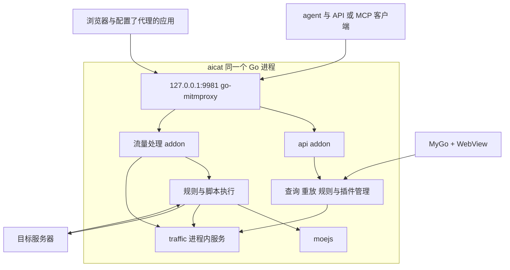

# aicat 第一期架构与插件设计

更新日期：2026-11-11。

aicat 的产品定位已于 2026-11-11 对齐为安装在用户节点上的常驻 Agent Gateway。Agent 是能力与管理接口的主要使用方，用户在自己使用的 Agent 中交互、查看结果和 review。桌面窗口提供接入、配置、认证、统计与诊断入口。完整定位见根目录 `CONTEXT.md`。

当前一期交付面向 macOS，已围绕本地 HTTP/HTTPS 代理、流量检查与规则管理构建 API/MCP 接口。下文的一期功能范围及运行架构记录该交付基线。AI 网关、MCP 聚合、Skill 分发及消息接入按新的产品方向逐项推进，详细流量检查的设计默认值调整为关闭。

技术栈采用 **mygo + go-mitmproxy + moejs**，由一个 Go 进程承载。`127.0.0.1:9981` 是统一 HTTP 入口，既接收代理流量，也承载 aicat 自身服务。不引入外部 runtime 二进制，第一期不引入 agentgateway。

本文记录从零重写的设计基线，不要求兼容历史代码或自动迁移旧业务，也不代表功能已经实现。已对齐的决定列在下表；其余实现建议和待定项分别在对应章节及文末说明。模块的 Go 接口见 [gateway 与 traffic 接口设计](gateway-traffic-design.md)。

## 已对齐的决定

| 项目 | 决定 |
| --- | --- |
| 产品主线 | 节点上的常驻 Agent Gateway，通过接口向 Agent 提供能力和管理操作。当前一期交付为 HTTP/HTTPS 代理、流量检查、规则与脚本插件服务 |
| 桌面框架 | 使用 MyGo + WebView，应用装配放在 `internal/app/`，Vue 3 + TypeScript + Vite 前端放在根 `ui/`，类型接口由 `internal/app/Desktop` 声明并生成客户端，参考 Codex 的界面结构及 mygo-music 的组件分工 |
| 代理实现 | 使用 go-mitmproxy，网关及业务在 aicat 进程内运行 |
| 脚本引擎 | 使用 moejs 执行用户编写的 JS/TS 插件 |
| 统一入口 | 9981 由内置网关监听，aicat 自身的 HTTP 服务也从该入口访问 |
| 功能启停 | 上层功能可关闭并隐藏导航；代理常驻，不提供停用开关 |
| UI 调用方式 | WebView 界面经私有协议调用进程内服务；9981 承载代理和对外 API/MCP |
| 插件钩子 | 保留 `onRequestHeaders`、`onRequest`、`onResponseHeaders`、`onResponse` 四个阶段 |
| 插件更新 | 不要求热更新；安装或修改插件后重启生效，不重新编译 aicat |
| 暂缓范围 | agentgateway、TUN、Tailscale/tsnet、多出口转发及 conn25 |

## 产品范围

一期围绕一条调试流程组织：接入代理，选择需要解密的目标，查看请求和响应，通过规则或脚本修改，再重放请求核对结果。用户在桌面中完成这些操作，agent 通过 API/MCP 使用相同能力。

接管范围是遵循系统代理或显式代理设置的 HTTP/HTTPS 客户端。第一期不承诺接管本机全部网络流量，也不处理 TUN、UDP 或通用 IP 转发。未选择解密的 HTTPS 流量通过 CONNECT 隧道转发，只能展示连接层面的信息。

| 核心能力 | 一期设计范围 |
| --- | --- |
| 代理接入 | 显式代理、macOS 系统 HTTP/HTTPS 代理启停、监听状态与错误展示 |
| HTTPS 解密 | aicat CA 创建与信任管理、按域名选择解密、未命中目标隧道透传 |
| 流量查看 | 实时列表、搜索筛选、请求/响应 headers 与 body、状态码、耗时、大小及失败信息 |
| 请求调试 | 编辑并重放单个请求、复制为 cURL、导出记录、返回自定义响应 |
| 改写规则 | 根据目标匹配，执行请求/响应改写或调用脚本，展示修改前后结果 |
| 动态插件 | 加载 JS/TS、按阶段调用、执行日志、错误定位、资源预算 |
| agent 接口 | 查询记录、读取详情、重放请求、管理规则与插件 |

SSE 与 WebSocket 在一期以正常转发和受限内容观察为目标，具体协议组合需要端到端验证。对 SSE 事件、WebSocket 消息和任意流式 chunk 的脚本改写不进入一期范围。

插件市场、插件自定义 UI、断点交互、批量压测和跨设备共享不进入本次交付。旧版 Codex Wiring、Provider、Claw、消息连接器等业务不自动纳入新版，历史代码可按新实现需要移除。

## 运行架构

### 组件职责

| 组件 | 职责 |
| --- | --- |
| mygo | 窗口、托盘、菜单、快捷键、桌面生命周期和界面绘制 |
| go-mitmproxy | HTTP 代理、CONNECT、TLS 解密、上游连接、协议处理与流量钩子 |
| moejs | 编译和执行 JS/TS 模块，提供 Go 与脚本之间的数据及函数调用 |
| aicat | 装配组件，管理配置、CA、系统代理、规则、插件、流量记录和 API/MCP |



托盘进程就是运行体，`aicat serve` 是同一份运行体的前台入口，不再派生长期服务进程。主窗口关闭后可继续由托盘承载；停止网关或退出应用时按系统代理恢复流程处理。

### 统一 HTTP 入口

同一 listener 识别三种请求形态：

| 请求形态 | 处理方式 |
| --- | --- |
| CONNECT | 根据目标与解密选择，进入 TLS MITM 或原样隧道转发 |
| absolute-form HTTP 请求 | 作为代理请求，进入流量处理 addon |
| 以 aicat 为目标的服务请求 | 由控制服务 addon 接入 API/MCP 的 HTTP handler |

本机服务请求在 go-mitmproxy 中使用 `AccessProxyServer`，不会自动进入代理的 `Request`/`Response` 钩子。`api` addon 接入 HTTP handler，由服务接口层完成路由、授权、操作日志与事件输出。流式服务响应还需要保留逐块 flush 的能力，不能假定底层 writer 包装自动保留该能力。

控制路由同时核对目标 authority 与保留路径，不能只匹配 `/api` 或 `/mcp` 这样的路径，以免截获目标网站的同名接口。具体路径及本机授权机制在接口设计时确定。控制流量默认排除在用户改写脚本和普通抓包记录之外。

WebView 界面经 MyGo 绑定的 Desktop 类型客户端调用进程内业务服务，通过 Channel 接收 Watch 合并后的变化，typed event 通知设置状态失效。MCP 与 HTTP API 经 9981 调用相同服务，复用数据模型、校验和业务规则；桌面绑定不监听 TCP，9981 不增加桌面管理操作。服务和 addon 不依赖 mygo，也不直接修改 UI 状态。

### 网关和 addon 边界

重写版按以下边界组织 Gateway Addon：

- `internal/gateway/` 是 go-mitmproxy 的装配，只处理入口、HTTPS 拦截白名单（解密选择）、CA 及生命周期，不承载业务规则。
- 涉及网关的业务放在 `internal/gateway/addons/<业务>/`，实现 go-mitmproxy 的 `proxy.Addon`。
- 控制服务路由、抓包、改写和脚本调用通过 addon 接入；持久化、插件 runtime 和业务查询可使用普通 Go 包，由 addon 或控制服务调用。
- 规则与脚本阶段由流量处理 addon 明确编排，避免依赖多个 addon 的偶然注册顺序。
- 库的缺口优先在 addon 侧适配，需要时向上游提交补丁，不维护 aicat 私有 fork。

### 出站连接与循环防护

区分两类 HTTP client：aicat 或插件主动发起的业务请求显式经过 9981；网关执行最终转发时使用直接连接的 transport。后者不继承指向 aicat 自身的代理环境变量。

当前 SDK v1 不向插件提供 fetch 或任何网络 API。后续若引入受控网络请求，需定义宿主 client、内部来源与重入限制；来源不能由外部 header 冒充，在此之前不启用该能力。

## 流量处理与记录

### 处理阶段

普通、可缓冲的 HTTP 交换按以下阶段处理：

```text
收到请求 headers
  → 保存客户端原始 headers
  → 匹配规则与插件，固定本次请求使用的配置版本
  → onRequestHeaders
  → 在需要且允许时读取完整请求 body
  → onRequest
  → 保存修改后的请求，发往上游

收到上游响应 headers
  → 保存上游原始 headers
  → onResponseHeaders
  → 在需要且允许时读取完整响应 body
  → onResponse
  → 保存修改后的响应，返回客户端
```

请求和响应 body 的原始内容在读取时、执行改写前留取。每个阶段按同一份确定顺序执行匹配规则与插件，后一个处理者看到前一个处理者提交的结果。请求生命周期内的配置版本固定，避免请求和响应两侧使用不同版本的插件。

headers 钩子没有 body，不控制无限缓冲。仅在 body 完整且受限时执行完整 body 钩子，空 body 与不可用 body 明确区分。onRequest 的自定义响应会短路上游，仍按相同规则顺序进入两个响应钩子一次。

### 流量记录

记录以一次 HTTP 请求/响应交换为单位，并保留关联连接、重放来源和插件调用的信息。展示内容包括：

- 客户端原始请求与实际发往上游的请求。
- 上游原始响应与实际返回客户端的响应。
- 命中的规则、执行插件、修改阶段、错误和耗时。
- body 的完整性、采集状态、截断原因，以及是否经过 TLS 解密。

请求 ID 从 1 开始自增，后续请求和响应阶段沿用同一个 ID，对应列表的 `#` 列。WebView 界面通过 traffic 服务的 Watch 一次取得初始列表与后续变化订阅，合并通知后读取最新状态；通知不另设事件编号或 Cursor。重启后内存记录清空，UI 重新加载并订阅。详细接口见 [gateway 与 traffic 接口设计](gateway-traffic-design.md)。

记录表达的是 HTTP 语义层内容，不承诺还原 TCP/TLS 原始字节。未解密 CONNECT 只记录可观察的连接与目标信息。headers 的多值、body 的二进制数据和内容编码需要在数据模型中保留，UI 可提供文本、JSON 和二进制查看方式。

当前采用有界内存记录与 body 前缀，重启清空；SQLite 与大 body 文件持久化不在当前实现内。容量默认值见 gateway/traffic 文档，持久保留与导出格式仍待确定。持久记录及导出沿用既有脱敏原则；重放脱敏记录时允许用户补齐缺失凭据，不能把脱敏占位符当作真实认证数据。

### 流式与大 body

go-mitmproxy 的 stream 模式不会进入后续完整 `Request`/`Response` 钩子。宿主必须分别调度 headers 处理、完整 body 改写和流式观察，不能通过无限缓冲让四个钩子在所有流量上都执行。

流式和大 body 应边读取边转发，采集量受限，取消与背压沿流量传递。超过完整 body 上限或属于一期不支持的流式改写时，跳过对应完整 body 钩子，并在记录中展示原因。采集截断不能截断实际转发的内容。

当前保留 `StreamLargeBodies` 的 flow 级流式行为：大请求会使响应也走流式，body 钩子记录 skipped。SSE 在 headers 阶段固定流式；Upgrade 请求跳过插件，第一版不支持 WebSocket 帧改写。

### 请求重放

重放创建一条新的流量记录，通过同一个代理处理流程执行，并关联源记录。用户可编辑 URL、method、headers 和 body。是否默认再次执行规则与插件，应在操作中明确展示；默认值尚未确定。

## JS 和 TS 插件

扩展包声明、安装记录和与现有改写服务的衔接方案见 [扩展包与改写能力设计草案](extension-packages-design.md)。草案待评审，以下仍描述当前已实现的 SDK 与运行边界。

### 插件与 Go addon 的关系

Go addon 是编译进 aicat 的宿主集成代码；用户插件是启动时加载的 JS/TS 模块。动态安装用户插件不需要生成 Go 代码、不加载 Go `.so`，也不重新编译 aicat。

SDK v1 采用以下目录，具体字段与 AI 编写流程见 [插件 SDK](../internal/mcpserver/guide.md)：

```text
~/.aicat/plugins/example/
├── plugin.json
└── index.ts
```

清单 apiVersion 1 描述 id、name、version、main（index.ts 或 index.js），只支持单文件模块，不提供 import/npm。插件启用状态、目标范围、顺序和运行设置统一写在 `aicat.yaml`。插件返回的数据和可选运行数据不是第二份行为配置。

安装或修改插件后重启 aicat 生效。不要求文件监视、热替换或正在执行请求的版本迁移。没有声明或导出的能力不显示为可用能力；加载失败的插件需有独立错误信息。

### 四个钩子

| 钩子 | 执行时机 | 能力边界 |
| --- | --- | --- |
| `onRequestHeaders` | 收到请求 headers，尚未读取完整 body | 查看和修改 URL、method、请求 headers |
| `onRequest` | 请求 body 完整可用 | 查看和修改请求 body，以及生成自定义响应 |
| `onResponseHeaders` | 收到响应 headers，尚未读取完整 body | 查看和修改状态码、响应 headers |
| `onResponse` | 响应 body 完整可用 | 查看和修改响应 body |

插件按需导出函数，不需要四个都实现。这四个阶段分别映射到 go-mitmproxy 的 `Requestheaders`、`Request`、`Responseheaders`、`Response`；它们是 aicat 的公开插件接口，不直接暴露底层 `proxy.Flow`。

保留四个钩子的目的是让仅改 headers 的插件尽早完成，让需要完整 body 的插件明确等待，同时保持大文件和流式传输可以继续转发。

### 数据接口

建议采用受控输入和显式结果：宿主为当前阶段准备数据，脚本返回修改结果，宿主验证后提交。脚本不持有可随意修改的底层连接或 `proxy.Flow`。

数据契约需要覆盖：

- headers 保留同名多值，尤其是多个 `Set-Cookie`。
- body 保留字节表达，文本和 JSON 读写由辅助 API 处理。
- body 状态区分完整、流式、未采集和截断。
- body 变化后，由宿主维护 `Content-Length`、内容编码和相关协议字段的一致性。
- 同一请求在四个钩子之间可传递显式上下文，不依赖某个 runtime 的全局变量恰好仍在使用。

以下是已实现 SDK v1 的基本接口；完整 body、上下文、自定义响应及运行限制见 SDK 说明：

```js
export function onRequestHeaders(request) {
  request.headers["x-aicat-debug"] = ["1"];
  return request;
}

export function onRequest(request) {
  return request;
}

export function onResponseHeaders(response) {
  response.headers["x-aicat-processed"] = ["1"];
  return response;
}

export function onResponse(response) {
  return response;
}
```

### 宿主 API 与资源管理

moejs 提供 JS/TS 执行及宿主绑定。当前宿主只提供有界 console 日志、host.settings、host.bodyText 与 host.bodyFromText，不提供网络、文件系统、进程或任意 Go 对象访问。headers 使用小写名称和多值数组，body 为解压后实体的 base64，完整空 body 为独立的空字符串。

TypeScript 使用固定版本 moejs 去除类型语法，不承诺 Node.js/Bun 兼容。入口与清单在保存时校验和编译，运行时不安装额外宿主权限。

启动时编译共享模块，每次调用创建独立 runtime，避免全局状态跨请求污染；message.context 显式保存同一规则在请求中的状态，最多 16 KiB。async 经事件循环完成，请求取消会中断运行与计时器，不阻塞 mygo UI。

默认每阶段总时限 200ms（含排队及该阶段规则链）、runtime 32 MiB、并发 8、完整 body 1 MiB；编译并发 2，离线试运行并发 2。运行预算用于约束成本，不等同于操作系统进程隔离。

### 错误处理

单个插件的修改仅在执行成功并通过结果验证后提交。抛异常、超时或结果非法时，保留该插件执行前的流量，记录阶段、错误及调用信息；已经由前序插件成功提交的修改继续保留。

第一版固定继续转发并记录错误，不提供失败阻断或自动暂停。普通错误继续后续规则；阶段总预算用尽则结束该阶段，仍保留此前成功结果。完整 body 钩子因流式或大小限制被跳过，应显示为跳过，不能误记为执行成功或脚本异常。

## 桌面界面

主窗口采用四个布局区域。下列英文名用于 aicat 的设计和代码沟通，不宣称是 Codex 内部组件名。

| 区域 | 英文约定 | 职责 |
| --- | --- | --- |
| 导航栏 | Navigation rail | 最左侧图标竖栏，切换一级功能 |
| 标题栏 | Title bar | 窗口控制与拖动区域，可与页头视觉整合 |
| 侧边栏 | Sidebar | 当前功能下的分类、会话、列表或筛选 |
| 主面板 | Main pane | 当前页面的主要内容与操作 |

标题栏横跨窗口，保持 48 DIP 单行；主面包屑与侧边栏右边界对齐。左侧导航栏 53 DIP、侧边栏 216 DIP，折叠侧边栏后主面板获得实际空间，前进、后退与切换按钮继续可用。流量列表与详情上下分栏、请求与响应左右等分，分隔条支持拖动。

一级栏目名（如“流量”“设置”）由顶部面包屑承载，侧边栏只展示子页面、分类和筛选，不再重复栏目标题。此约束通过 E2E 检查真实无障碍树中侧边栏的后代节点；进入设置、历史前进后退、折叠再展开后都必须成立。静态 lint 不根据文案字符串判断 UI 所处区域。

导航栏提供常驻的“扩展”模块。侧边栏直接承载搜索与可折叠的已安装、内置、推荐列表，主面板展示选中扩展的详情、状态和操作；这些分组不是三个页面入口。搜索当前只筛选内置扩展，社区搜索、安装与更新尚未接入，社区入口和已安装列表明确显示占位，不提供无效安装按钮。流量开关从设置迁入其内置扩展详情，设置仅保留通用和代理。现有脚本插件继续由 MCP 管理，本轮不把它们接入社区列表。

内置扩展统一管理上层功能。当前仅列出已实现的流量功能，其开关保存为唯一配置文件中的 `features.traffic`，缺省开启。关闭后停止采集新请求、隐藏流量导航及采集操作，既有观测继续完成，记录在有界内存中保留至淘汰、清空或退出。代理及只读 API 继续运行，用户未配置使用代理时不会接管系统流量。导航历史跳过已关闭的功能；全部上层功能关闭时，启动进入流量扩展详情，账号菜单、快捷键和托盘设置入口始终可达。重新开启保留本次会话的暂停状态；重启后从功能配置恢复，不持久化临时暂停状态。

功能开关和 HTTPS 解密名单通过同一串行化、原子替换的配置更新入口保存，保留未知字段与注释。保存成功后才更新运行状态；保存失败保留原状态并显示错误。未来新增上层功能遵循相同启停与导航规则，不提前列出尚未实现的开关。代理是基础设施，不加入可关闭功能列表。

当前 UI 提供流量、扩展与设置，规则、脚本插件由 MCP 管理，暂不增加相应页面。流量侧边栏依次展示固定域名、域名/路径树与应用分组，英文标签为 Pin、Domain、App。应用行分别显示当前列表中的 HTTP 请求数和未解密 CONNECT 隧道数，点击按应用筛选并保留 URL 搜索，应用与域名是两个独立入口。域名按 host 聚合，路径忽略 query 聚合；选中域名筛选其全部请求，选中路径包含它的子路径并遵守路径分段边界。展开/收起独立于选中；收起已选路径的祖先时筛选回到可见祖先，收起当前筛选分组时回到全部。域名右键固定/取消固定，配置项 traffic.pinnedDomains 跨重启及清空保留。没有固定项时只保留分组标题与数量。分组和条目仅使用需要的展开箭头、文字和数量。

主搜索仅做完整 URL 的大小写不敏感文本匹配。侧边栏导航清空搜索，前进/后退恢复导航时的筛选、搜索与所选请求；已清空或淘汰的记录不会复活，不为每个输入字符创建历史。标题栏录制按钮单击暂停/继续，代理转发持续运行；不使用下拉菜单。列表为 #、URL、Method、Status、Time、Size；只在实际数据行使用浅色差隔行底色，空白区域纯色，不显示 URL 后的改写/锁图标。详情保持请求与响应双栏，各提供 Header / Raw，默认显示 Header；两侧独立保留本次运行选中的视图，切换请求不重置。Header 以名称/值表格显示，长值换行，同名多值分别保留；复制仅包含当前视图内容，成功或失败提示紧邻复制按钮并自动消失。列表只同步摘要；详情和正文按需读取有界快照。请求行右键支持复制 URL、复制 cURL、固定/取消固定所属域名，与侧边栏固定状态和配置保存共用逻辑；复制 cURL 保留方法、URL、headers 和文本正文并正确处理 shell 引号，CONNECT 隧道或采集不完整的正文禁用该项。Raw 保留正文文本的空白与格式，二进制以 hex 显示，截断与采集状态在正文外提示。HTTP 头部来自解析后记录，不能保证原始大小写/顺序；响应协议版本不可得时显示 HTTP，不伪造版本。CONNECT 左侧显示连接请求的 Header / Raw，右侧保留加密与启用域名解密入口。顶部额外搜索图标与底部 Cmd+K 搜索提示移除。私云尚未接入时只显示状态说明，不显示无效的登录按钮。

代理页的监听地址使用纯 IP 下拉框，默认 127.0.0.1，同时列出 0.0.0.0 和本机网卡 IP；端口单独编辑，范围 1–65535。点击“应用”后立即切换，成功才保存 gateway.addr，重启保留。可并行监听时先启动新入口，同端口重叠时先释放旧入口并在失败时恢复；采集记录、CA、解密名单和规则运行体保持。系统代理已开启时同步切换到可达的本机目标（通配监听使用 loopback），保存/切换失败尝试回退，回退自身失败则保留恢复所需的监听并显示错误。代理地址与 cURL 示例复制按钮均已移除。底层内部服务释放的已知限制见 gateway/traffic 文档。

使用 MyGo + WebView：根 `ui/` 放独立的 Vue/TypeScript/Vite 工程和构建资源，Go Desktop 服务生成 TypeScript 接口，`internal/app/` 装配服务并适配窗口、托盘、菜单、剪贴板和系统对话框。业务服务继续独立于 UI。通信使用 MyGo 官方绑定、事件和 Channel；默认构建不暴露额外 HTTP 管理端口。

布局、尺寸和间距以 ChatGPT 桌面应用为参照，主题颜色继承 netcat。具体度量与视觉稿由 UI 设计会话细化，早先估算的固定尺寸不作为实施依据。

暗色强调色沿用 netcat 网站：品牌主色与高亮文字为 `#00bba7`，选中背景为 `#123b38`，避免额外提亮为浅薄荷色或使用偏灰绿的填充。保留当前中性灰底色；浅色主题不随此次调整变化。HTML 稿与原生调色板保持相同定义。

排版、颜色和组件样式以 `docs/design/aicat-shell.html` 的快照为参照，提取到 `ui/src/design.css`，桌面适配集中在 `ui/src/layout.css`。系统字体和等宽字体由浏览器选择平台回退，Retina 不另行放大。

| 用途 | 字号（DIP）与字重 |
| --- | --- |
| 普通界面 | 13，常规 400，1.5 倍行高 |
| 侧边栏、搜索与列表 URL | 12，常规 400 |
| 状态、计数、表头与辅助说明 | 11，常规 400 |
| Raw 栏目名 | 13，500 |
| 设置页标题 | 20，600 |
| Raw 请求行、headers 与正文 | 12，等宽 400，1.65 倍行高 |

搜索工具栏 44 DIP、搜索框 28 DIP、表头 27 DIP、数据行 30 DIP、详情摘要 42 DIP、Raw 栏目条 34 DIP、底栏 27 DIP。图标采用 24×24 viewBox、1.5 线宽，常规显示 17 DIP、按钮命中区 29 DIP；导航图标显示 19 DIP。配置和业务状态使用真实服务，不为模拟稿的展示数据增加临时会话概念。

URL 搜索在框架无关的 JS 页面中实现模糊成员匹配，大小写不敏感，字符顺序一致即可、不要求连续；空白分词后以 AND 组合，各词顺序不限。例如 `rspns` 命中 `responses`，`chat cmpl` 命中 `chat/completions`。只匹配完整 URL，与域名/路径筛选取交集，结果保持采集顺序，不按匹配分数重排。标点按字面匹配，不接入 fzf 扩展查询语法；API/MCP 的既有查询语义保持原样。

HTML 稿与正式页面复用样式参数与组件约定。虚拟行承载真实流量列表，DOM input 保持编辑状态，Raw 提供 34px 行号栏、文本选择与不含行号的复制。Header/Raw 按请求和响应分别保持当前窗口内的选择。系统保存面板保持 macOS 原生。浅深色的几何度量和强调色进入 E2E，保存实际页面与设计稿截图。

## API 与 MCP

API 和 MCP 是进程内业务服务的对外适配，暴露相同的业务能力，复用规则校验和错误语义，并在入口执行授权。agent 能力先围绕一期调试流程展开，不自动扩展为任意宿主机操作工具。

| 能力组 | 操作范围 |
| --- | --- |
| 流量 | 查询列表、搜索、读取详情及采集状态、订阅新增记录 |
| 调试 | 编辑参数后重放、读取执行结果、导出记录 |
| 规则 | 查询、创建、更新、排序与启停 |
| 插件 | 查询已安装插件、读取加载状态和执行日志、管理启用及运行设置 |
| 运行状态 | 查询网关、CA、系统代理状态，按授权执行管理操作 |

MCP 使用同一 9981 的 /mcp，官方 Go SDK 的 Streamable HTTP，凭据位于 Home/mcp-token（0600）。提供规则/插件 CRUD、排序与启停、编译校验、离线试运行、SDK 工具/资源和流量查询；具体 schema 由工具声明及 SDK 说明维护。规则管理服务供 WebView 界面直接复用，UI 页面本轮不新增。插件安装、执行环境变更、证书信任和系统代理写入需沿用对应的用户授权边界，不能因调用来源是 agent 而自动扩大权限。

## 配置与生命周期

`~/.aicat/aicat.yaml` 是唯一持久行为配置，保存监听设置、系统代理接管意图、解密范围、规则及插件运行设置。配置格式需要版本管理、校验及避免覆盖并发修改的写入流程。

CA、流量记录、body、插件代码、日志及系统代理恢复日志属于各自的文件或运行数据。恢复日志记录撤销所需信息，不承担开关配置。

继续沿用现有 CA 与系统代理约定：

- aicat CA 在本地生成并复用，私钥留在 aicat Home。信任安装由用户显式操作，并以实际验证结果展示状态。
- 系统代理首次默认关闭，与证书信任独立；启动不自动触发证书安装。
- 接管前保存原设置，监听就绪且满足接管条件后再设置系统代理。
- 关闭系统代理、停止网关或正常退出时恢复原设置；异常退出后的下一次启动先执行恢复。
- 恢复冲突保留外部修改并报告错误；正常退出恢复失败时按既有约定保留网关，避免留下不可用代理。
- 强制终止无法保证即时恢复，不以 UI 开关状态推断客户端流量已经进入代理。

详细行为继续以 [ADR 0020](adr/0020-macos-certificate-and-system-proxy.md) 为准。

## 验收设计

以真实客户端、真实 socket、测试 CA 和可控上游完成端到端验证。开发期间只运行当前变更相关的检查，交付时执行适用的完整 E2E 和 release 构建验证，不新增事后补写的单元测试。

| 场景 | 可核对的结果 |
| --- | --- |
| 统一入口 | 同一端口同时响应 aicat API/MCP、明文代理与 CONNECT，外部同名路径不被误路由 |
| 选择性解密 | 命中目标呈现测试 CA 签发证书；未命中目标保持隧道透传 |
| 四阶段脚本 | 上游与客户端分别核对 headers、body 的修改结果，执行顺序可追踪 |
| 动态插件 | 安装或修改脚本后重启生效，aicat 二进制保持不变 |
| 插件故障 | 验证异常、死循环中断、非法返回值、并发及取消，不拖住 UI 或污染其他请求 |
| 流式与大 body | 上游结束前客户端已收到内容，跳过原因可见，实际转发内容不被采集上限截断 |
| 重放 | 新记录关联原记录，编辑生效，规则执行模式符合用户选择 |
| API/MCP | agent 可查询、读取详情和重放，授权及脱敏与桌面业务一致 |
| 系统状态 | 在隔离适配器下验证接管、恢复、冲突和异常重启流程 |
| 桌面交互 | 导航、流量查看、规则编辑、插件状态与错误信息可通过真实界面操作核对 |

每次最终验收生成带依赖版本和运行参数的报告，附合成请求/响应、流量导出、插件执行日志及界面截图，保留复跑命令。测试通过 `--home <隔离目录>` 使用独立的 aicat Home、测试 CA 和替换的系统设置适配器，不使用真实的 `~/.aicat/`，不修改真实用户 Keychain 或 macOS system proxy。当前构建与验证入口见 [开发约定](development.md)。

## 与现有架构文档的关系

| 现有约定 | 重写版处理 |
| --- | --- |
| [CONTEXT.md](../CONTEXT.md) | 记录当前重写版的领域语言；历史 Claw、消息渠道和 Wails 桌面代码已移除，旧业务不自动迁移 |
| [ADR 0016](adr/0016-tray-app-with-capability-switches.md) | 常驻托盘形态保留；Wails 技术选择被本次已对齐的 mygo 方向替代，主窗口扩展为调试工作界面 |
| [ADR 0018](adr/0018-go-mitmproxy-entry-with-addon-business.md) | 保留 go-mitmproxy 装配和 addon 业务边界，扩展通用抓包与脚本能力 |
| [ADR 0019](adr/0019-tray-process-serves-aicat.md) | 保留同一进程运行及 `aicat serve` 入口，UI 框架相关细节随 mygo 迁移调整 |
| [ADR 0020](adr/0020-macos-certificate-and-system-proxy.md) | 保留 CA 用户授权、系统代理保存与恢复约定 |
| [现有 UI 对应关系](ui/magpie-port.md) | 属于当前实现；新布局按本次设计推进，不机械移植旧页面 |

历史 ADR 和代码作为参考，不构成重写版的兼容约束。实施时需要明确归档或更新相应 ADR、构建约定和领域文档，避免旧版 Wails 架构与新实现长期并存而没有说明。

## 待细化的设计项

| 事项 | 当前状态或建议 |
| --- | --- |
| 界面细节 | 一级导航内容、标题栏范围、分栏与折叠交互待定 |
| 控制接口 | MCP 已实现 Streamable HTTP、Bearer 与 authority/Origin 检查；HTTP 查询保持原接口 |
| 插件 SDK | v1 清单、四钩子、base64 body、context 和自定义响应已实现，见 SDK 说明 |
| 插件执行 | 按当前请求重新匹配、有序事务化执行；短路响应进入响应链；错误回退并继续转发 |
| 资源预算 | 已实现有界 body、阶段总预算、runtime 内存与并发上限，见 SDK |
| 脚本网络 | v1 不开放；来源标记、重入排除与嵌套上限留待后续 |
| 记录存储 | 当前有界内存；持久保留与导出格式待定 |
| 重放 | 默认使用哪个请求快照、是否重新执行规则与插件待定 |
| 协议覆盖 | HTTP/2、SSE、WebSocket 与解密/流式组合须以 E2E 收敛实际支持范围 |
| 配置生效 | 规则与插件保存后均重启生效，保存与运行版本分别显示 |
| 旧业务取舍 | 旧业务不自动纳入一期，如需重新引入则另行定义能力范围 |

## 参考资料

- [mygo 文档](https://github.com/egoist/mygo/tree/main/docs)：桌面生命周期、原生 UI、窗口和后台状态更新。
- [mygo-music](https://github.com/egoist/mygo-music/tree/1af0d8efd77fdf630c27cfc635f12e9cb089ce10)：参考 mygo 界面与 moejs 插件宿主的分工，不将其音乐业务模型引入 aicat。
- [go-mitmproxy addon 接口](https://github.com/lqqyt2423/go-mitmproxy/blob/v1.9.4/proxy/addon.go)：代理阶段与本机服务接入钩子。
- [go-mitmproxy Flow](https://github.com/lqqyt2423/go-mitmproxy/blob/v1.9.4/proxy/flow.go)：流式处理与完整 body 钩子的关系。
- [moejs 指南](https://github.com/MoeForge/moejs/blob/main/docs/guide.md)：模块、runtime、事件循环、宿主能力和网络 client。

上述资料用于说明集成方式。实施时固定具体依赖版本，并以该版本源码和端到端结果验证行为。

## 当前原型落地范围（2026-11-09）

已实现 MyGo WebView 窗口、go-mitmproxy HTTP/CONNECT/按域名 MITM、有界 traffic 服务、9981 的只读 HTTP API。WebView 窗口按「UI」对话原型稿组织 TitleBar、NavRail、域名 Sidebar、请求列表和下方双栏详情；支持正文/Headers/概览、搜索、暂停采集、清空、主题和账号菜单中的设置入口。

规则与 moejs 四阶段改写及 MCP 管理现已接入后端，SDK 和执行诊断可由 agent 读取；规则/插件 UI 待另一轮设计收敛。私云登录、TUN/Tailscale、导出与重放仍未实现。原型的运行方式、验证工件和上游 CONNECT 资源限制见根 README。

应用名称统一为 `aicat`。native 应用提供系统托盘及打开窗口、暂停/继续采集、设置、退出菜单；关闭主窗口时隐藏窗口，代理和采集继续运行，显式退出时销毁托盘并停止服务。CLI `serve` 保持无 UI、无托盘。


### 原生代理与证书设置

证书与解密域名直接放在代理设置中，设置保留通用、代理子页面，功能启停归入扩展；无额外“高级设置”和配置路径常驻说明。代理提供地址复制、cURL 示例和独立系统代理开关；证书卡片只展示状态、安装证书和管理证书入口；删除后显示未安装，仍使用同一安装证书入口。用户点击安装直接进入 macOS 授权，页面原位显示进度、实际检测结果及可重试的错误，不添加应用内继续确认。

新增根证书名称统一为 aicat；既有 go-mitmproxy CA 身份和存储布局继续复用，公开证书由当前载入的根导出，私钥保持 0600。信任服务独立于 UI 和 gateway，检测当前用户按精确指纹对应的不受用途限制根信任，再验证实际 SSL；未检测、取消、错误、过期、其他同名 CA 和仅导入均不显示已信任。证书详情展示真实名称、有效期和 SHA-256。过期证书明确显示错误，不静默更换已受信任身份。

精确域名可增删，输入拒绝 URL、端口、通配符和非法域名，支持 IDNA 规范化与 IP。CONNECT 详情就地保留目标，可安装证书后启用；客户端自行配置信任时提供明确入口，不将 macOS 系统信任作为所有客户端的唯一前置条件。旧连接不切断，新连接才使用最新名单。

系统代理遵循 ADR 0020 的当前用户授权、独立开关、逐命令恢复日志和冲突保护；原生退出时先恢复，再关闭代理。测试构建用独立 OS 适配器替换证书信任与网络写入，真实 UI、配置保存、命令规划、恢复和代理流量保持真实，不修改系统钥匙串或真实网络服务。

### 根证书管理与删除

用户只管理一个根证书身份，本地根证书及私钥与当前用户钥匙串中的公开副本具有同一指纹。管理菜单提供查看、导出公开 PEM、打开钥匙串、重新检测信任及删除。导出不含私钥，拒绝覆盖内部证书目录。保存文件使用系统原生面板。

删除有独立确认，说明会撤销当前用户信任、删除本地根证书与私钥，并断开现有代理连接；其他设备及用户自行导出的副本需自行移除。`internal/certificate.Authority` 实现上游 `cert.CA` 接口，仅管理身份生命周期，签发与缓存仍复用 go-mitmproxy。开始删除先写入持久删除标记，解除上游 CA 引用并阻止后续签发，网关保持监听，新 HTTPS 连接直通。既有连接统一断开，以免 TLS 会话继续持有旧证书。域名选择和流量历史保留。

系统移除仅针对精确根指纹：移除 user domain 信任，并在当前用户钥匙串搜索列表（包含默认钥匙串）中移除对应公开证书；跳过 System/admin 存储，不按名称删除。验证目标用户信任与公开副本均已移除后，才清理本地身份文件及旧版公开 `.cer` 导出。授权取消、系统或文件清理失败时显示删除未完成，保留重试材料并继续直通，崩溃后也不重新加载旧私钥或自动安装信任。

删除成功后只有删除标记留作生命周期状态，属于身份运行数据，不是第二份行为配置。再次启动不自动生成 CA；用户点击“安装证书”时生成缺失的新根，随后直接进入系统安装与信任授权，内存使用新的上游 CA 和叶子缓存，原有客户端需重新安装新证书。取消授权保留已生成的同一根供安装重试；不存在单独的创建步骤。第一次使用且没有删除记录时仍沿用首次本地生成策略。
